Pour le FIC deux, pentesters de l'équipe Audit ont réalisé un challenge IoT dont voici la solution.
Il débute par la consultation de la documentation disponible à cette adresse : https://github.com/hackvens/iot-doc

On y apprend que la première étape est de consulter le script python pour l'allumage du système :

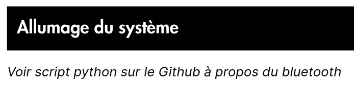

L'état de la box IoT est le suivant après son branchement :

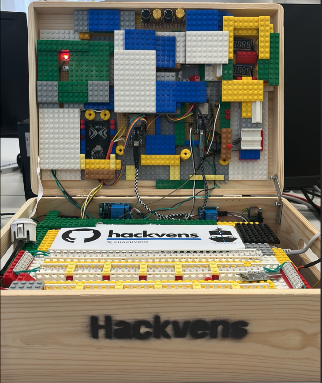

Un scan des équipements Bluetooth disponibles permet d’identifier le nom Pwn2Survive :

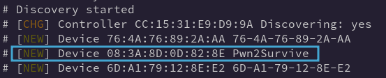

Ce nom est présent dans le script de démarrage de la Box :

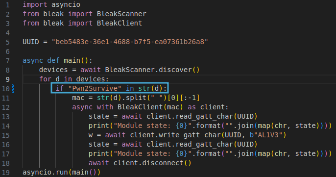

Son exécution permet d'allumer la box :
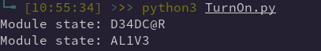

Qui passe dans un nouvel état :

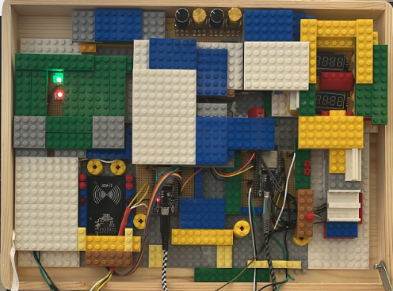

Nous pouvons passer à l'étape suivante de la documentation, où nous apprenons qu'il faut générer un tag NFC avec l'UID indiqué :

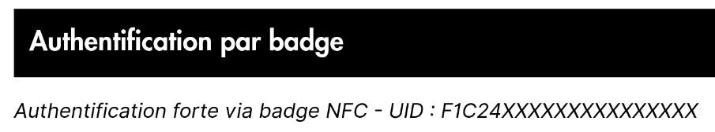

Un lecteur est présent et permet de valider cette étape :

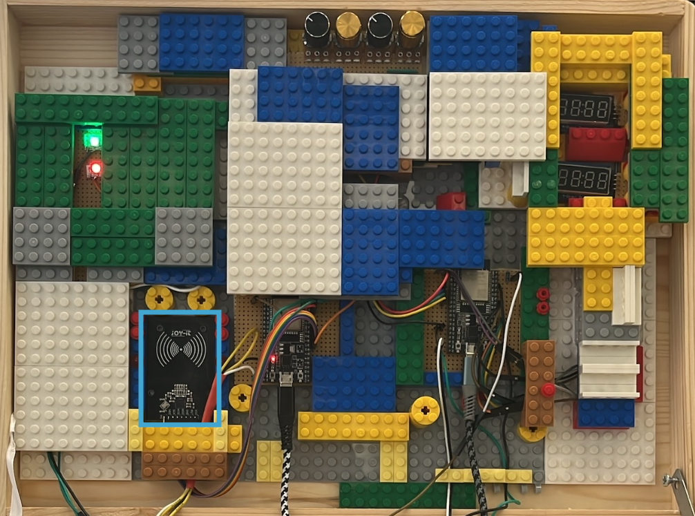

Nous créons un badge avec l'UID attendu à l'aide de la commande suivante :

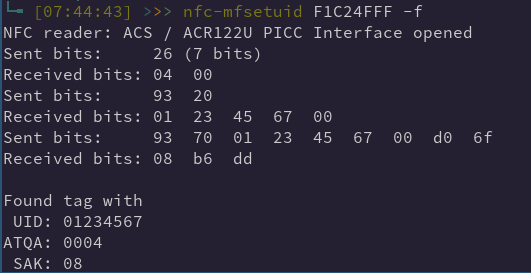

Nous vérifions sa valeur :

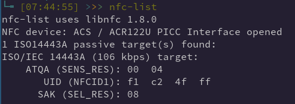

La lecture du badge active de nouveaux modules :

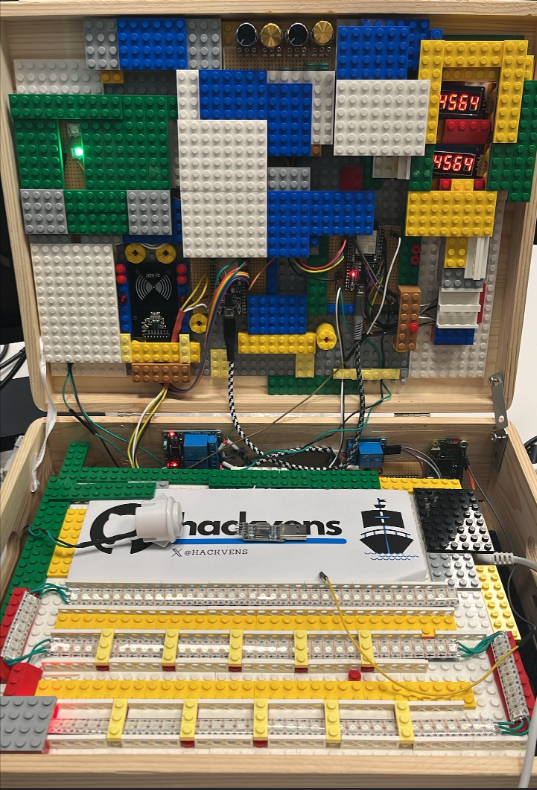

La 3ème étape nécessite l'utilisation de l'interface UART du RaspberryPi Zero :

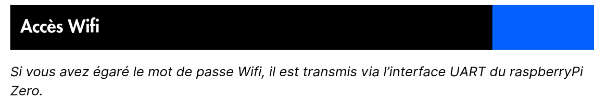

Les GPIO nécessaires sont les suivantes :

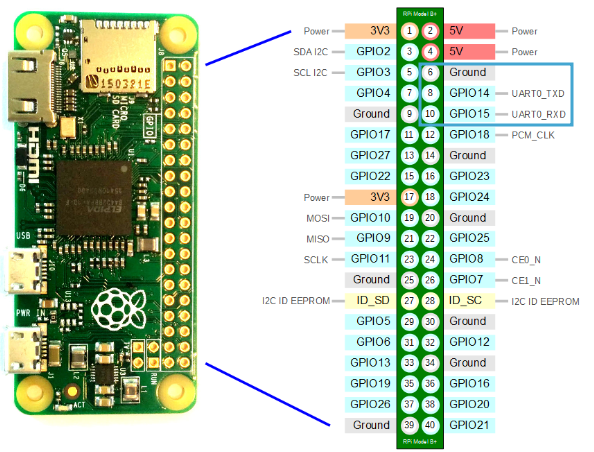

Le connecteur gris se trouve sur la terre, le rouge sur le TxD et le cable orange sur le RxD

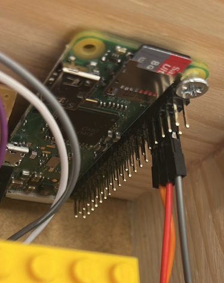

Le gris devient le jaune vers le connecteur, le rouge devient le bleu et le cable orange devient le vert.
Mais une erreur de débutant est faite ici :

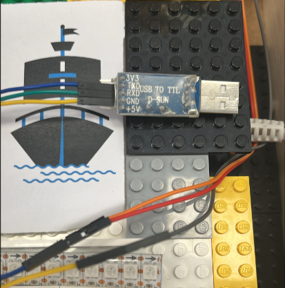

Lors de l'utilisation d'un convertisseur UART vers USB, il faut inverser la connectique TxD et RxD.
Ce qui est transmis via l'interface du Raspberry Pi (TxD) doit être réceptionné par le convertisseur (RxD).

Un deuxième point d'attention réside lors de l'utilisation de la commande `screen` afin d'obtenir une connection Série.
Lors de l'utilisation du Bite Rate 115200 par défaut nous n'avions aucune donnée retournée.
Il est ici possible de ne pas définir de valeur, ce qui nous permet d'obtenir le mot de passe du Wi-Fi :

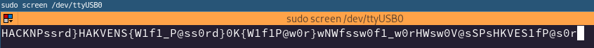

Une fois connecté, nous obtenons l'adresse IP suivante :

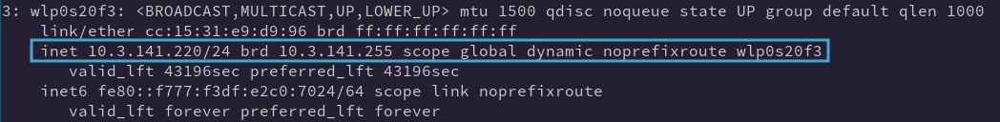

La dernière étape nécessite de consulter l'application :

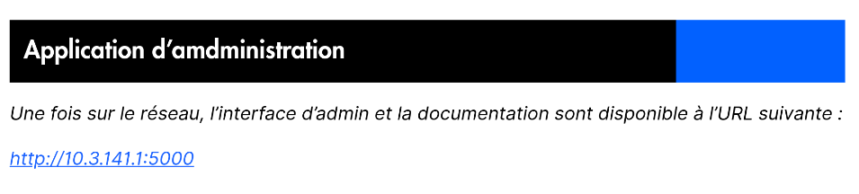

Une page de documentation et une interface d'authentification sont disponibles :

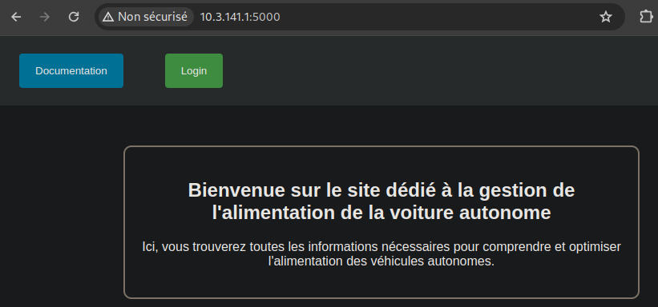

Chaque potentiomètre permet de modifier les valeurs affichées.
Nous utilisons alors les valeurs présentes dans la documentation :

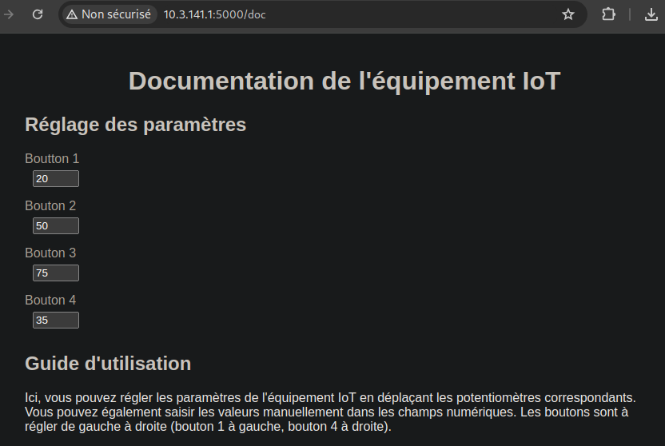

Mais nous n'obtenons pas le résultat attendu.
Après l'utilisation du bouton d'allumage nous n'avons pas d'arc en ciel :

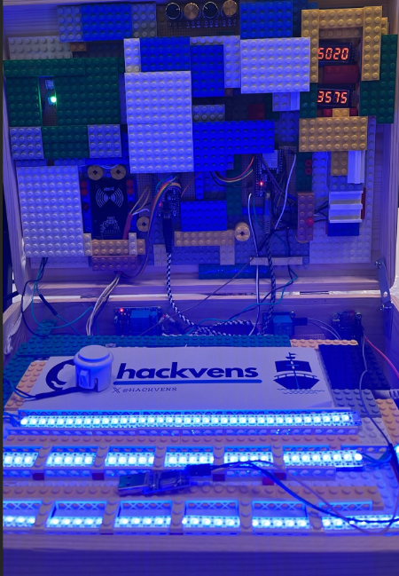

Nous passons donc à l'interface de connexion dont les identifiants sont triviaux (admin/admin) :

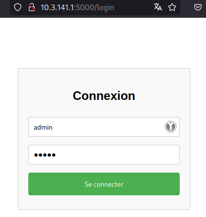

Une fois connecté nous apprenons que les valeurs ont changé :

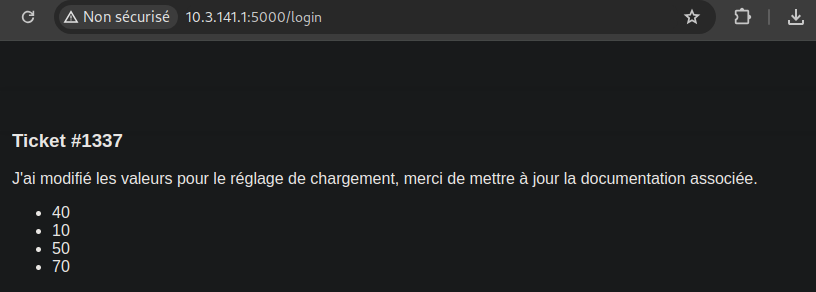

Après l'utilisation des valeurs attendues, le challenge est validé par l'affichage d'un arc en ciel :

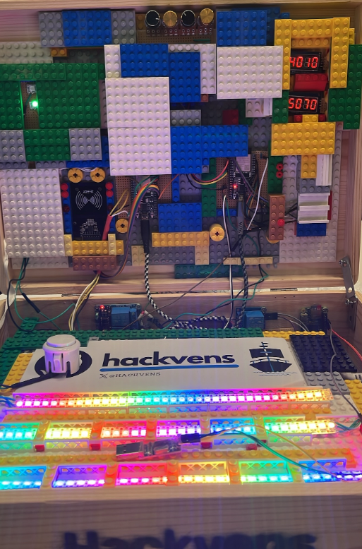

Anthony.
